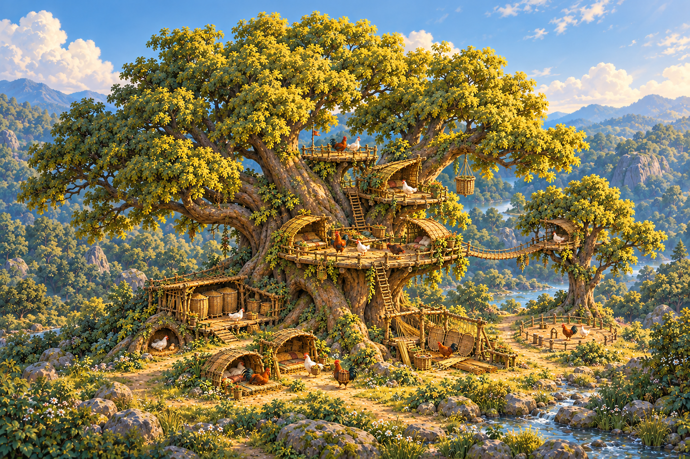
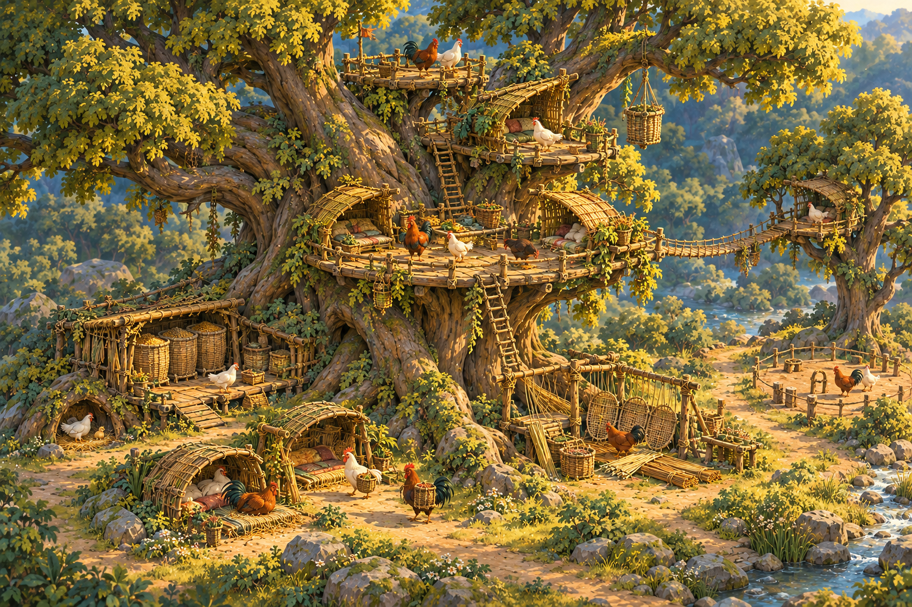
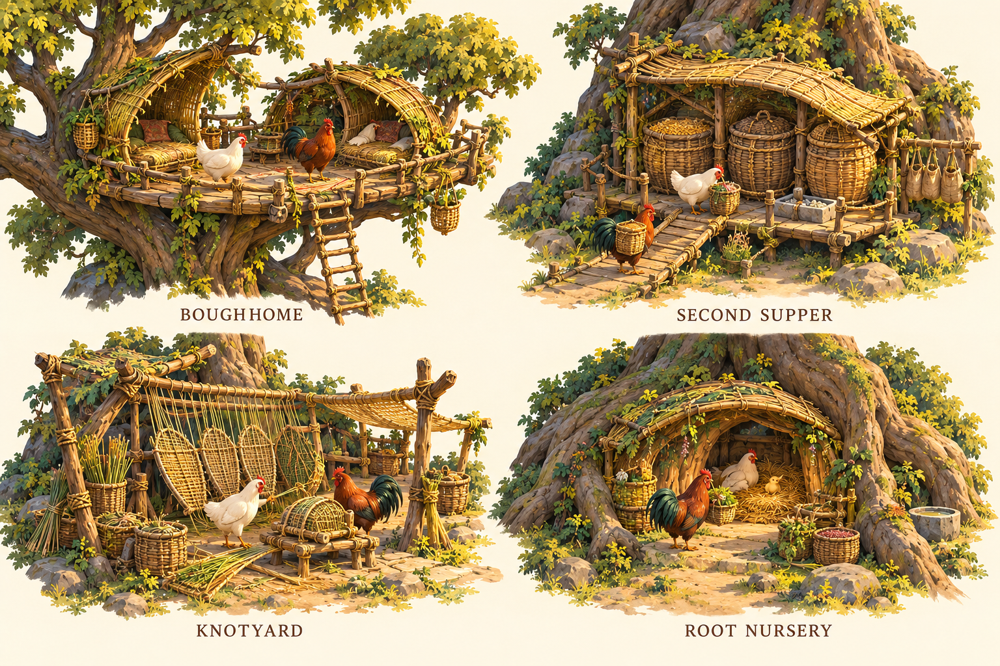
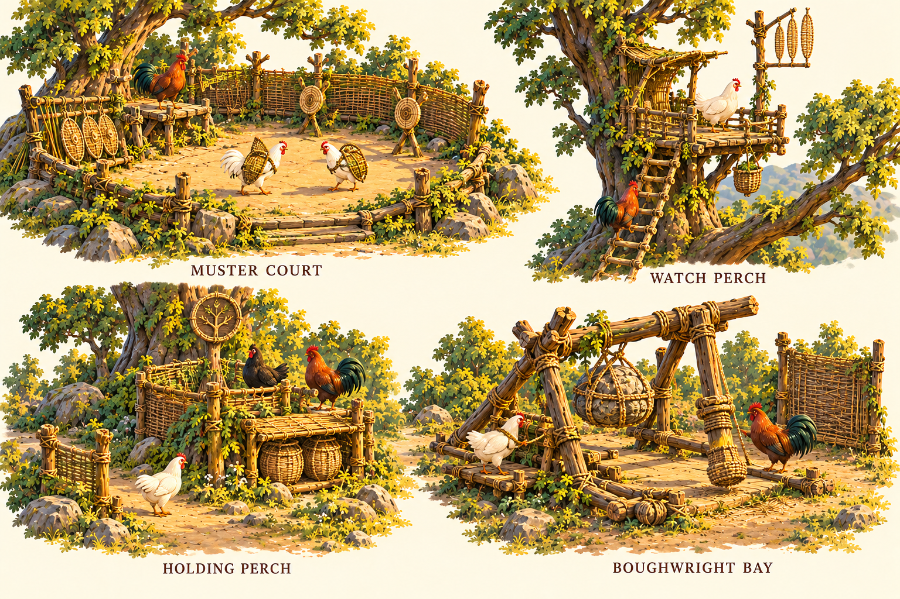

# Chicken Civ building art direction

27 October 2026 · Concept direction and first bounded reed habitation kit

The buildings should make a chicken civilization recognizable at a glance: **woven shelter around living forks, practical workshops at the roots, and military works facing the approaches**. The [building story and design](../story/proposals/chicken-civ-buildings.md) owns their proposed functions and narratives. This art develops that proposal and the user's supplied tree-village reference. It does not establish accepted models, new runtime buildings or engineering feasibility.

## The inhabited grove

The whole-grove composition keeps the tree's crown and roots in view. A strong fork remains visible behind three unequal terraces. The largest home porch faces the open court; the stores, workshop and recovery places sit below. The small watch position faces outward. The bridge is an exploratory connection to a neighboring tree, not a claim of implemented access.

The close composition is the material and habitation reference: irregular wood, curved reed hoods, layered lashings, warm occupied porches and cool shadow beneath the structure. It intentionally serves as a detail view; its crown is cropped. Use the whole-grove version for silhouette and spatial hierarchy. Both images are generated concept paintings, not screenshots of the current Babylon scene.

## Home and work kit

| Building | Keep from the concept | Resolve in an authored asset |
| --- | --- | --- |
| Boughhome | Two separate folded hoods around an open porch; living fork visible; supported floor; distinctive household spaces | Actual usable floor and cargo clearance; simplify bedding into woven mats; make every brace and ladder connection real |
| Second Supper | Three-basket silhouette, receiving ramp, low heavy stock, fitted carrier packs | Distinguish covered protein from visible staples; provide actual loading and passing places; tie fill states to stock |
| Knotyard | Open crooked tension frame, broad panel fan, material stacks beside an active job | Beak/foot operation and jig grips; fewer props at tactical distance; only show the object actually being worked |
| Root Nursery | Low crescent hood, sheltered threshold, grounded chick and caregiver, nearby meals | Build between roots without excavating a living trunk; preserve two dependent places and zero adult capacity; usable ground access |

These are not four skins on a common house. The home has a paired hood; the depot has containers; the workshop has an exposed frame; the nursery has a low protected entry. Their identities should survive muted color and a small silhouette thumbnail.

## Muster and frontier kit

| Building | Keep from the concept | Resolve in an authored asset |
| --- | --- | --- |
| Muster Court | Roofless horseshoe, practice targets and a small speaking perch | Keep entry and training space clear; armor must fit wings and gait; show training adults rather than spawning units |
| Watch Perch | Narrow outward platform, forked call-frame silhouette, modest side shelter | Valid sight and approach; practical resting and passing space; no vision bonus inferred from the decorative vanes |
| Holding Perch | Compact low duty porch, limited parapet, small woven crest and nearby stores | Separate the post's control state from the store's inventory and the tree's allegiance; use legible relief activity |
| Boughwright Bay | Low heavy horizontal apparatus, visible load, large lashings and two crew positions | Gatebreaker force path, release and crew actions require mechanical/animation study; the pictured hanging striker is exploratory |

The woven crest is a proposed sign of presence, not an approved faction emblem. The board uses both hens and roosters, but its generic birds are scale and activity studies, not approved portraits of Tansy, Bracken, Vetch or another named individual. A small comb or feather color alone must never define authority or occupation.

Field Store is the portable, low form of the supply kit, suggested by the paired covered containers at the frontier post. Wingrest appears as the two ground-level adult recovery bays in the grove composition. Neither has a dedicated turntable or orthographic sheet yet. Thornwork, screens, hauling baskets and ladders are infrastructure in the kit; their actual mechanical behavior stays with the story/rules proposal.

## Shape language

Use three scales of form. First is the tree and its principal forks. Second is the building's distinctive shelter, storage volume or apparatus. Third is a limited set of load-bearing ropes, rails, steps and job-specific props. An attractive close view should not become a field of equally important threads at the strategy camera.

**Homes curve inward.** Hoods and porch edges gather around the household while leaving its entrance visible. **Workplaces open outward.** Jigs, receiving places and material faces address the ground court. **Military places face a direction.** A watcher, practice screen or defended porch has a readable front and a readable flank. These are visual commitments, not invisible defense modifiers.

Prefer asymmetry with a reason: the floor bends around a branch; a hood stops short of the cargo shaft; a brace follows a load into a fork. Avoid random crookedness. A post may be irregular and still visibly vertical enough to bear weight. Rails protect occupied edges without sealing every platform into a basket.

Do not wrap every trunk in a perfect circular balcony. Do not cover every useful surface with a roof. Leave the host's largest fork and a generous canopy window visible. The reference's appeal comes partly from how much of the tree remains a tree.

## Materials and light

| Material | Visual treatment | Where it earns detail |
| --- | --- | --- |
| Living bark | Long directional creases, broad warm planes, cool shaded furrows | Root buttresses and visible load-bearing forks |
| Fabricated wood | Worn honey-grey surfaces, visible grain direction, a few fitted joints | Floor edges, braces and machinery; supply rule remains open |
| Reeds and weave | Bundled fibers and broad weave rhythm, restrained fraying | Roof edges, basket rims, folded panels and harness fittings |
| Cord | Clear purposeful wraps, larger knots at load transfer | Platform supports, hoist attachment and moving apparatus |
| Stone | Heavy muted grey, earthy contact and limited moss | Ground footing or low supply trays; not decorative roof weights |
| Foliage and ground | Olive variation, soft moss at damp contacts, warm grass beyond shade | Frame occupied spaces without hiding routes |

Warm directional light and cool ambient shadows should separate birds from the shelter behind them. Keep cream feathers readable without blown highlights. Dark cavities need enough fill to show a resting bird. None of this depends on bloom, cinematic depth of field or color grading that conceals geometry.

The images contain more fabric-like cushions, regular plankwork and repeated small decorative baskets than the production kit should retain. Translate bedding into grass mats and reed bolsters. Retain baskets that carry, store or grow something with an intended role; remove arbitrary hanging ornaments. Do not reproduce generated joinery where its load path cannot be explained.

## Chicken scale and working space

The art ruler is a roughly 0.75 m standing adult, consistent with the current study's `.45625` presentation scale and approximately 0.68–0.82 m adult-height range. Exact body, tail and cargo bounds come from the current source assets; the concept pixels are not measurements. Keep a reusable adult scale reference in every later modeling scene.

| Concept allowance | Initial spatial target, subject to modeling |
| --- | --- |
| Single carrier passage | 1.0–1.2 m clear width, plus the verified cargo envelope |
| Receiving or turning place | 1.5–1.8 m clear space; no through-traffic through a patient or working jig |
| Boughhome module | Approximately 4–5 m external terrace width; usable area excludes the trunk, rails and access opening |
| Small ground store or work module | Approximately 3–4 m overall span; delivery lanes counted separately |
| Muster practice area | Approximately 5–6 m clear court across before surrounding works |

These figures are composition studies, not placement footprints, pathfinding clearance, structural certification or implemented occupancy. Large buildings cannot be dropped into the current small map without checking how much maneuvering space they consume. Do not shrink the chickens to make a crowded kit fit.

Young remain on the ground in this proposal. A low threshold must truly meet the ground. Every elevated destination needs a real arrival place and a route appropriate to its user; a ladder drawn against the tree is not enough. The current cargo basket does not carry birds. Proposed litter movement needs two operators and a turning path. Preserve separate space for heavy goods, passing birds and quiet care.

## Evolution through visible additions

The base vocabulary should survive technological growth. A new home alcove fits another supported fork; an older rainhood remains alongside it. Packed Provision puts fitted packs and a packing position into the existing depot. Counterweight Haul makes the loading landing and shaft more important. A siege trial places heavy apparatus in the Knotyard's Boughwright Bay. None of these requires every roof to change color when a global tier advances.

Use retained construction and repairs to make history legible. Personal expertise appears in practiced actions and appropriate equipment. Office appears through the responsibility being performed and a restrained sign when needed. A master is not simply a larger chicken, and a captain does not require a palace.

## Visible building states for later production

Plan a shared state vocabulary while giving each building its own meaningful objects. A marked site has a readable work boundary. Delivered material is a finite pile. An assembled frame lacks the unfinished floor or hood. A useful building has complete required access. An unstaffed workshop holds a parked job; it does not animate fake output. A store changes fill with actual stock. A vacant duty post has no pretend garrison.

Damage and abandonment variants wait for explicit rules about which works can be damaged and how people and goods survive. A civilian ruin must not quietly establish a new war mechanic. Reduced motion preserves essential status through fixed object states and text; decorative flutter is optional.

## Original concept review and later implementation boundary

The original concept pass proposed the paired-hood Boughhome, three-basket Second Supper, open Knotyard and low Root Nursery as a coherent design family. The frontier board established contrasting silhouettes; the overview explored their coexistence while the tree remains dominant. The later approved first slice is the bound-reed home, current reed store and ground nursery described below. The broader ten-building proposal remains a proposal.

Larger fabricated-timber buildings and mechanical systems still need their supply, access and gameplay decisions. The first reed kit instead preserves existing recipes and measured habitat anchors. Its compact playable home and separate full-size Longbough hood mount share an authored shell/material family; the study does not add simulated housing or transplant the large tree into Woodland.

The [asset pipeline](asset-pipeline.md) remains the production owner: editable source, proven scale, embedded materials, clear provenance, runtime import/disposal, narrow layout, reduced motion and measured browser performance. Concept approval does not substitute for that evidence. The original concept-only pass changed no runtime assets; the separately authorized kit now has actual source/exports and integration qualification linked below.

## Generation record

All four PNGs were generated with the **built-in image generator**, directed in this task and copied without image editing. [Exact prompts and reference relationships](concepts/buildings/provenance.json) and [file hashes and dimensions](concepts/buildings/manifest.json) preserve the sources. The user-supplied reference is described in provenance but is not copied into the public repository. No claim is made that generated concepts are dimensionally accurate, mechanically validated or final production art.

## Authorized first playable habitation kit

The 27 October implementation uses bound reeds and woven fibers for the **existing** Boughhome (`treehouse`), local reed store and ground nursery. This deliberately stays within the current six-/four-/four-reed recipes; it does not introduce fabricated timber, a new technology gate, food or stone stock in the reed store, extra occupancy or a new scenario. Playable Woodland adults keep their existing .365 presentation scale and exact saved berths/access anchors. The larger Longbough art study keeps .45625 adults and a separate host-fitted hood module; its staged figures are not occupants. Concept module dimensions above remain future allowances, not current footprints.

The playable home uses unequal, open-sided hoods with curved partial returns and grass/reed sleeping mats. Its right berth also lies beside the existing upper-deck transit route; the art must leave that route open rather than imply two private enclosed rooms. The dedicated ground nursery replaces the old renderer’s borrowed home hood and basket, while retaining actual dependent care, food and egg state. Its empty nest is not an automatic brood. The local store renders only actual saved reed bundles.

Construction reveals delivered bundles, then the authored base, frame and finished hood/container from saved construction facts. It never squashes a finished structure to suggest progress. The preexisting upper-deck approach exposed an actual torso intersection during saved descent; a separately exported, same-anchor art correction now clears the qualified actual-body samples, with old bytes preserved. No route migration is part of this slice. Its short steep approach is an open, tied-grip clamber with supported endpoints/berths, not a continuous walking floor. Actual access is unburdened; hypothetical cargo clearance is a design margin, not a supported cargo-on-ladder journey.

Current implementation and acceptance evidence belong to [habitation-kit qualification](../output/building-implementation-v1/README.md). The first integrated slice has local journey and actual-camera qualification; the primary accepted its shelter/hatch/clamber direction. These compact first assets do not establish the larger proposal’s tech ladder, balance, capacity or production art quality.
