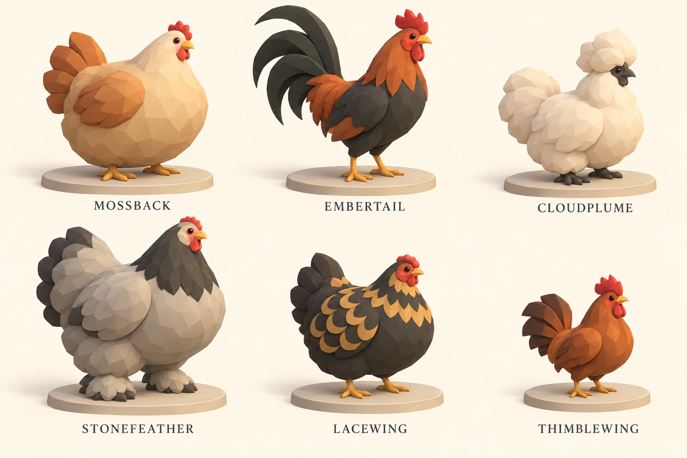
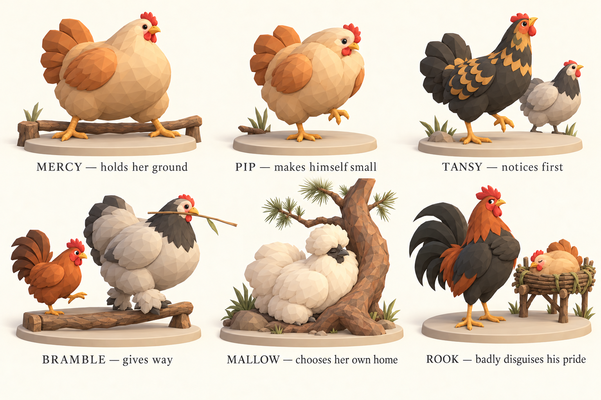

# Chickens with lives behind their eyes

**Status:** Astra creative exploration, October 16, 2026. The user accepted the new tree art direction and requested the same depth for chickens and their kinds. The chicken names, bodies, acting, and production recommendations below are proposed. The PNGs are generated concept art, not game models or verified runtime screenshots. No production chicken assets or new lineage mechanics have been integrated.

The art should make a player recognize a particular hen crossing a distant walkway, then understand her mood when they move closer. Chickens remain chickens: their human emotional lives are carried by bird anatomy and behavior. They do not need clothes, hands, weapons, or human faces to become ambitious, jealous, chivalrous, insecure, or loved.

## Recommendation: sculpted bodies, expressive bird acting

Use the same warm, faceted, matte 3D language as the accepted [tree exploration](tree-design-exploration.md). Broad body masses, large readable wings and tails, clean color areas, small dark eyes, and restrained feather groups should survive the elevated settlement camera. The body must be appealing at rest, legible among roots, and unmistakably alive in motion.

The initial lineage plate established variety but over-rendered feathers. The second board is the stronger production direction: simpler sculpture with visible differences in mass, carriage, crest, feet, and tail. It still needs simplification and actual-camera proof. The acting sheet then tests whether bodies can express different people rather than just different breeds.

## Six working lineages, one chicken society

These are fictional domestic-chicken lineages inspired by real breeds. They are not six separate biological species, automatic political factions, jobs, or personality classes. The word “lineage” is a worldbuilding label; the game has no implemented inheritance model. Do not infer a genetic simulation from these designs.

| Working name | Visual identity | Reference and useful constraint | Acting opportunities |
| --- | --- | --- | --- |
| **Mossbacks** | Deep, broad pear; warm buff and russet; short tidy tail; weight close to the ground | Orpington's broad, deep body and full feathering | A nearly motionless hen can command space; the same body can withdraw into a worried huddle. |
| **Embertails** | Slim upright carriage; charcoal and copper blocks; long clean tail arcs | Leghorn-like light carriage; junglefowl color reference kept separate from domestic breed identity | A lookout's sudden height, a proud sidelong glance, or a rooster pretending not to care. |
| **Cloudplumes** | Compact soft volume; sculpted crest; dark little face and feet; ivory or slate | Silkie-inspired soft plumage; a full Silkie body cannot be treated as a normal flying body | Small head turns inside a soft silhouette, a doubtful pause, deep relaxed settling beside a trusted trunk. |
| **Stonefeathers** | Tall substantial chest; broad pale/dark blocks; feathered shanks and feet; low pea comb | Brahma-inspired size and feet; limited flight must inform routes | Deliberate weight, an unexpectedly delicate step, patience that suddenly becomes firmness. |
| **Lacewings** | Compact middle-sized body; a few bold lacing motifs; low rose comb | Wyandotte-inspired lacing, rose comb, and weak flight | Quick investigative head angles, an abrupt warning freeze, skepticism without human eyebrows. |
| **Thimblewings** | Small adult proportions; compact fan tail; mature face and stance | True bantam/Sebright inspiration, not a scaled chick | Expansive confidence in a tiny body; a quick sidestep that reads as courtesy rather than defeat. |

The labels are working creative names, not a requirement to display six fantasy categories constantly in the UI. Individual names should become more important than lineage labels during play.

### Biological reference boundaries

- [Oklahoma State: Orpington](https://breeds.okstate.edu/poultry/chickens/orpington-chickens) and [The Livestock Conservancy: Orpington](https://livestockconservancy.org/about-us/conservation-successes/orpington-chicken/) support the broad, deep reference body.
- [The Livestock Conservancy: Leghorn](https://livestockconservancy.org/leghorn-chicken/) supports the light carriage and active non-industrial reference. [Cornell: Red Junglefowl](https://www.allaboutbirds.org/guide/Red_Junglefowl/id) is a separate wild-species reference for male color and tail. Embertail is a fictional design, not a claim that these names are interchangeable.
- [Oklahoma State: Silkie Bantam](https://breeds.okstate.edu/poultry/chickens/silkie-bantam-chickens) describes its distinctive feathers, extra toe, and flightlessness. The final model needs deliberate foot and feather treatment; the concept image is not an anatomy authority.
- [The Livestock Conservancy: Brahma](https://livestockconservancy.org/brahma-chicken/) supports large size, feathered shanks and toes, a pea comb, and difficulty flying over low fences.
- [The Livestock Conservancy: Wyandotte](https://livestockconservancy.org/about-us/conservation-successes/wyandotte-chicken/) supports the rose comb, lacing, and poor flight.
- [The Livestock Conservancy: Sebright](https://livestockconservancy.org/sebright-chicken/) describes a true bantam with no standard-sized counterpart, compact form, and the ability to fly into trees to roost. The Thimblewing concept borrows size and mature bearing; its chestnut color is fictional, not a breed-standard plate.

These sources inform morphology and mobility. They do not establish characters' professions, intelligence, courage, morality, social rank, or tree allegiance. Reported breed temperament must never become a deterministic personality caste.

## The same body must play different people

**Mercy and Pip are the most important pair on this sheet.** Both are broad buff Mossbacks. Mercy plants her feet and keeps her breast forward; Pip draws his head into his shoulders and hesitates. If the player can distinguish only color or accessories, the character design has failed. Their exact names and personalities are examples, not replacement canon for the current runtime cast.

**Tansy** shows why warning is an acting problem before it is an icon problem: neck extends, one foot freezes, the gaze points toward danger, nearby birds respond. A hen can be the first watcher and decisive protector. Roosters can be chivalrous, vain, or antagonistic without monopolizing competence.

**Bramble** is small but socially assured. He makes room deliberately. Yielding on a walkway should be distinguishable from losing a confrontation. The animation can carry confidence through gaze, a measured backward step, and the absence of panic.

**Mallow** chooses a pine as home. Her soft body does not confine her to a soft-looking tree. She begins at an accessible low fork; her desired upper home creates a reason for the community to build. Her attachment to Needlewick follows experience, not a Cloudplume→Pine class bonus.

**Rook** is proud of useful work and wishes nobody would notice. A glance back at the finished roost, a tiny chest lift, and an affected look away can say more than a thought bubble marked “pride +5.” The generated panel conveys his stature better than his sideways acting; animation must complete the idea.

## A practical acting vocabulary

| State or action | Bird performance | Must remain distinct from |
| --- | --- | --- |
| Ordinary travel | Alternating steps, modest head stabilization/bob, tail balance | Constant comic bouncing |
| Carrying | Weight and beak-held load affect posture; large loads use appropriate supported transport | Human-handed carrying or an object floating beside a wing |
| Investigating | A pause, one eye brought toward the object, small head reorientation | Generic idle twitching |
| Warning | Sudden stillness, neck reach, directed gaze, then a readable call/response | A permanent combat stance |
| Yielding | A sidestep or backward step with intentional gaze | Fear, injury, and submission sharing one animation |
| Rivalry | Occupying space, stiff carriage, measured approach, sharp reactions | Every rooster constantly attacking |
| Affection/belonging | Relaxed proximity, settling at a familiar place, willingness to share space | A compulsory heart icon over every relationship |
| Roosting | Feet grip a supported perch, body lowers, plumage settles, head tucks | A bird suspended inside a branch or arbitrary hover offset |

Every gesture must stay useful at the real camera. Some close-up nuances belong in inspection moments; the main world should communicate through larger posture and movement changes. No large dialogue UI is required to make every feeling legible.

## Individuation, age, and sex

Read identity in this order: **silhouette → carriage and movement → large plumage pattern → individual details**. A broken tail tip, one pale wing patch, a habitual head angle, or a distinctive little comb can help, but do not pile all markers onto every bird. Names and remembered actions finish what art begins.

Hens need a full range of commanding, scruffy, elegant, curious, and proud silhouettes. The first plate's uniform large-rooster/small-hen pairing is not a rule. Sexual dimorphism varies by lineage and individual; do not assign every male a towering body and every female a subordinate stance. No decorative eyelashes, lipstick, or human-coded outfits are needed.

Chicks, juveniles, and adults need actual proportion and plumage changes, not just uniform scaling. A small adult bantam must remain visibly mature. Avoid universal pink-versus-blue sex cues. Later inheritance can reuse coherent visual traits, but its rules are a separate design decision.

The first art proof should use a modest number of compatible bodies and meaningful deformation tests. Some body types may share a rig with adjusted joints and animation; a crest, short soft tail, or feathered feet still require deliberate treatment. Do not promise one skeleton with arbitrary scale sliders will cover every silhouette.

## Trees and bodies must fit each other

The opening four-adult fixture remains flight-capable and starts on the ground, using natural roosts before construction. That fixture is not a universal biology rule. Future full Silkie-like bodies need a low natural safe berth or a physically valid route, not invented flight. Large or weak-flying bodies need distances and branch access that match their capability. A tree preference cannot override reachability.

Prove the mismatch as a story opportunity: a bird may want a place she cannot yet reach. Build a ladder or other access, show her using it, and let the completed work become part of her relationship with the builder and tree. Never introduce a body into the opening population without supplying an honest overnight solution.

Architecture should make different bodies look at home: broad landing places for larger feet, believable branch grips, low comfortable pockets, passing space on shared walks, and visible room to turn with a load. These are design considerations to verify, not a demand for six duplicate building catalogues.

Color connects chickens and trees through a shared world palette, not fixed uniform allegiance. A rust-colored hen should remain legible against warm bark. Pale birds need enough value separation from bright birch. Dark birds need readable eyes and silhouette in shadow. Check twilight, foliage overlap, and selected-state treatments without neon faction paint.

## What the boards prove, and what they do not

1. **[Lineage plate v1](concepts/chicken-lineages-v1.png):** explores body and plumage variety. Too much feather detail, overly consistent male size dominance, and comb inaccuracies. Useful for alternatives; not the production target.
2. **[Sculpted models v2](concepts/chicken-models-v2.png):** recommended shape language. Stronger broad masses and distinct feet/crest/tails. Lacewing still has too many repeated scallops; Cloudplume needs fewer tufts at distance; Stonefeather's pea comb and Lacewing's rose comb require authoritative correction in production modeling. The display plinths and image framing do not establish exact world scale.
3. **[Acting v1](concepts/chicken-acting-v1.png):** validates different emotional intent within the same lineage and offers relationship staging. Several poses remain close to neutral, Bramble's passing space is too tight to use as a path specification, and Rook's intended sideways glance is under-expressed. Mercy and Pip are the clearest pair. These are animation briefs, not completed animation acceptance.

None proves topology, skinning, collision, asset size, performance, animation quality, or readability at the actual settlement camera. The concept camera is closer and lower than much of normal play. Do not reproduce the detail density blindly in GLBs.

## Smallest convincing production proof

Use the accepted tree style and this chicken direction together in one actual-camera scene before producing the full cast. Build a broad hen and a contrasting light bird first; validate the challenging fluffy/feather-footed forms in a subsequent body test rather than assuming they fit automatically.

The proof needs neutral travel, one carrying journey, deliberate yielding, a warning pose, ascent appropriate to the body, and settling in a visible natural or built roost. Put two individuals of one body type in the same scene and distinguish them without nameplates. Show one character in sun, shade, twilight, and behind a partially overlapping crown.

Acceptance belongs to the rendered browser scene: readable silhouette and load, grounded feet, visible routes, convincing size against ladders and branches, retained identity at ordinary zoom, and measured performance. Set export/detail budgets from that evidence. Keep the [asset pipeline](asset-pipeline.md), [visual bible](visual-bible.md), and [tree kinships](../story/tree-kinships.md) aligned.

All three chicken boards were made with the built-in image generation tool. Exact prompts and reference relationships are preserved in [chicken-prompts.md](concepts/chicken-prompts.md).
