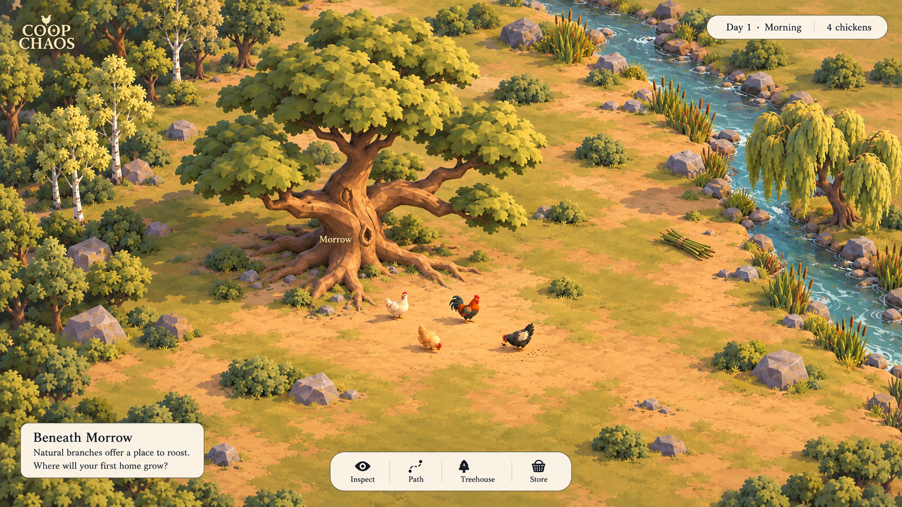

# Beneath the canopy: the art-led sandbox MVP

**Status, October 16, 2026:** the accepted next direction is a living sandbox led
by the quality of its world and inhabitants, with basic foraging and building.
There is no authored story arc, mandatory first-home sequence, or dialogue gate.
The images below are generated concepts, not game screenshots. The current
Node-authored tree/chicken GLBs are **visually rejected** against this target;
their working construction, roosting, and save behavior remains reusable.
The incremental playable art study includes bounded autonomous food foraging;
full visual acceptance against this brief remains open.

## The visual promise

Four chickens live beneath a tree that looks capable of becoming their entire
world. Its crooked trunk, muscular forks, open crown and warm root court make it
a memorable individual. Natural branches already offer sleep. Empty forks invite
woven homes, while productive commons and a creek suggest work beyond the roots.
The pleasure is watching particular birds inhabit a beautiful place, then making
small useful changes and seeing them respond.

**Version 2 is the visual acceptance reference.** Preserve its sculpted tree
anatomy, canopy depth and gaps, convincing bird bodies, warm material relationships,
soft lighting, broad clearing and restrained interface. The whole crown belongs
in the frame. Simplify noisy foliage and grass where readability requires it,
without reducing the tree to stacked slabs or birds to indistinct primitives.
A bitmap background, generated concept, file named GLB, or successful load is not
proof of this quality in a playable 3D scene.

The [earlier close view](concepts/opening-view-v1.png) remains mood evidence only;
its cropped canopy, foreground blur and busy ground are weaker gameplay choices.
The user's [tree exploration](tree-design-exploration.md), especially the natural
roost in [Longbough progression v2](concepts/longbough-progression-v2.png), and
[chicken models v2](concepts/chicken-models-v2.png) supply artifact references.
Their generated details require anatomy and runtime judgment, not literal copying.

## A place that lives without a quest

**Home sits left of center.** A heavy swept trunk, uneven roots and asymmetric
canopy establish character without a face. Crown gaps frame natural perches,
landings and future homes; foliage must not conceal the very work the player
commissioned. No house or ladder is required for the opening adults to sleep.
Morrow is a proposed character/restaging from [tree kinships](../story/tree-kinships.md),
not permission to rename Lowfork or reinterpret a loaded save.

**An open court holds work and encounters.** Four distinct, flight-capable adults
begin on the ground. Separate their silhouettes through body form, plumage and
purposeful posture. Hens retain equal dignity; the rooster is not a giant hero
surrounded by anonymous workers. Show deliberate footfalls, scratching, pecking,
pickup, carried weight, weaving and rest when their underlying activity exists.
Random idle acting must not impersonate gathering, vigilance or a relationship
system. A bird's path, task and observed response should explain what it is doing.

**Forest homes meet productive commons.** Different tree silhouettes and quieter
background masses give the grove depth. The clearing, water and resource patches
orient the player and leave real routes legible. Keep legal work cells clear of
misleading decorative obstacles. Forest does not mean guaranteed safety; open
land is not barren. Rival kingdoms, territorial rules and predators remain future.
Do not introduce those systems to make a painted scene seem active.

## Minimal direct actions, autonomous activity

The direct actions are independent options, not tutorial steps:

- **Rest or open a food place.** Guide an existing local opportunity; birds
  choose feeding places autonomously. Show scratching and pecking at the chosen
  ground, food depletion and an individual appetite response rather than granting
  a global resource on click.
- **Commission a treehouse at an eligible tree.** Preview the real anchor, access,
  inputs. Free ground movement, local stores and physical deliveries
  support the home; they remain usable secondary tools rather than a prescribed
  sequence every player must follow.
- **Inspect an individual.** Reveal identity, current activity, condition and
  observed history. Explain an implemented preference through its cause; do not
  invent affinity meters, hidden needs or personality AI to decorate a card.

The bounded implementation now separates three mixed-food places from finite
construction reed patches. Food supports autonomous appetite-driven feeding,
idle browsing, individual preferences, remembered productive ground and tick-based
unused-place recovery. Reeds yield physical building material and do not regrow.
Exact capacities, rates and preference weights are provisional playtest tuning;
full diet, water, danger and richer ecology remain future. These rules do not
lower the actual-camera visual acceptance bar.

Stories emerge through repeated work, encounters, remembered contribution and
changed behavior. No first delivery, house or evening is a required plot beat.
The existing contributor attachment is one narrow reusable behavior; full tree
agency, family capabilities and social relationships are not implemented.

## Required artifact inventory

These are concrete production deliverables for this bounded art proof, not a
final asset count or permission to expand the economy.

| Artifact | Required proof |
| --- | --- |
| Hero home tree | Editable sculpted trunk, roots, substantial irregular crowns and open forks; natural perch, ground approach, home and ladder anchors visible at the fixed camera. |
| Forest-edge kit | Contrasting secondary trees and restrained undergrowth, ground clumps, stones and reeds; depth and family/growth-form distinction without a wall of identical crowns. |
| Four individual adult birds | Credible compact bodies, heads, beaks, wings, feet and tail fans; distinct silhouettes/plumage, all compatible with the opening fixture's flight. |
| Movement and work set | Ground travel, turns, idle/rest, scratch/peck, pickup/carry/drop, weaving, fly-up/down, perch settling and earned ladder use; authored poses/transitions with no sliding cargo or feet. Forage clips depend on the eventual rule contract. |
| Resources and patches | Readable existing reed cache, bundle, cargo and salvage; food habitat/yield/depleted/recovering states tied to the implemented rules. |
| Woven home and supporting store | Delivered-material and construction stages, usable branch deck, rain hood, ladder/landing, local stock and occupancy; chicken-made material craft rather than miniature human cottages. |
| World, materials and light | Warm root court blending into sage ground, shoreline/water, soft contact and branch shadows, controlled surface detail and quiet background; readable birds and routes at actual scale. |
| Fixed-camera interface | Small contextual actions and inspector, legible selection/placement cues, accessible secondary logistics/save controls; no camera pan, zoom, pinch or Find controls. |

Keep editable sources, material/texture provenance, exports, versioned anchor and
pose contracts, and close artifact views. Runtime evidence must show actual meshes
and materials, not a concept sheet substituted behind the game.

## Prove the authoring route before expanding the map

The immediate dependency is an **actual asset-authoring route that can achieve
this target**, not another broad renderer rewrite. The present Node exporter
proves editable geometry and loading, but its output failed visual acceptance.
No qualified Blender source/rig workflow has yet been established for this repo.
Blender or an equivalent editable DCC is the intended candidate; installation or
choosing a tool alone does not prove a usable route. See [asset pipeline](asset-pipeline.md).

The next bounded feasibility proof should author one hero tree, one representative
bird with movement/work poses, and a reed bundle plus a woven-home/access sample.
Inspect anatomy, canopy depth, materials and motion close up; export through the
actual Babylon loader and place them together at the intended fixed gameplay
camera. Preserve exact simulation attachment contracts or map them deliberately.
Use this proof to establish production effort and measured asset budgets before
making all variants, replacing the forest, or adding foraging rules. If the route
cannot produce the required quality, report that limitation rather than relabeling
primitive geometry as finished art.

## Browser acceptance and compatibility

Compare the real fixed-camera scene side by side with opening-view-v2, then
inspect close tree, bird, resource and building views. Require the intended anatomy,
materials, light and readable motion in both; fidelity is not satisfied by matching
layout alone. Show the fresh opening, useful natural roosts, active work and an
inhabited built home. For food foraging, prove Rest/Open, autonomous
work and visible resource consequences rather than an animation-only patch.
Exercise independent actions and observation, not a scripted story completion.

In the eventual integrated browser proof, preserve selection, legal placement,
placement cursors, cargo, ladder/perch occupancy and saved work through
reload. Check console, loading/failure/retry, reduced motion, narrow framing and
readable controls. Measure real scene performance on the tested device and report
its limits; no universal performance claim follows from a local sample.

The current fresh fixture is Fern, Rook, Dapple and Wren at 40 reeds, no sites,
cargo or attachments. Lowfork, Splitcrown and Reedside each have two natural
berths. A treehouse costs six reeds and adds two sheltered berths plus access;
a store costs four and holds twelve. These remain provisional code values.
Current saves may restore an advanced settlement: retain stable IDs, personality,
material, routes, jobs, sleep and memory. New forage state needs an explicit
simulation/save contract before implementation; do not silently reinterpret reeds.

Use fixed elevated framing with responsive composition, no camera navigation or
zoom. Pause, day/evening, save status, import/export, restart protections, keyboard
selection and grid navigation remain accessible. The concept's “Day 1 · Morning”
is proposed copy; current rules expose day/evening, not a calendar. A narrow view
must keep both the world and actions usable rather than shrinking birds to dots.

See [visual bible](visual-bible.md), [settlement design](../story/settlement-design.md)
and [roadmap](../docs/roadmap.md) for the wider direction and current boundaries.
Exact image prompts and reference roles remain in
[opening-view-prompts.md](concepts/opening-view-prompts.md).
