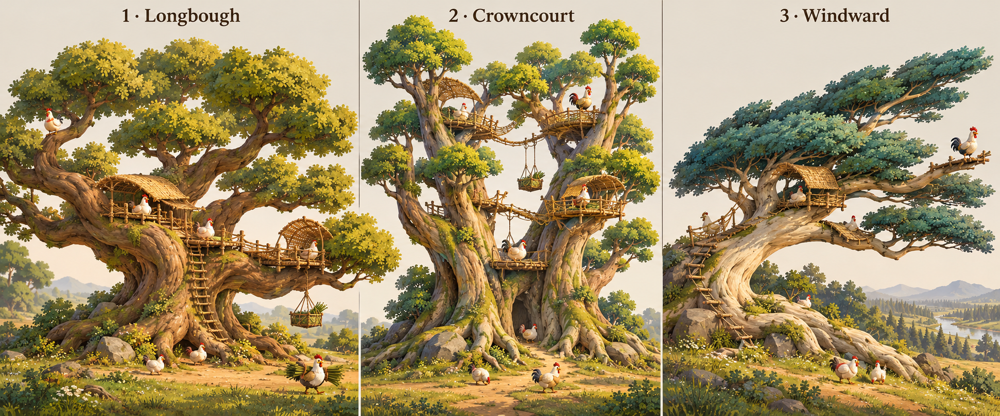
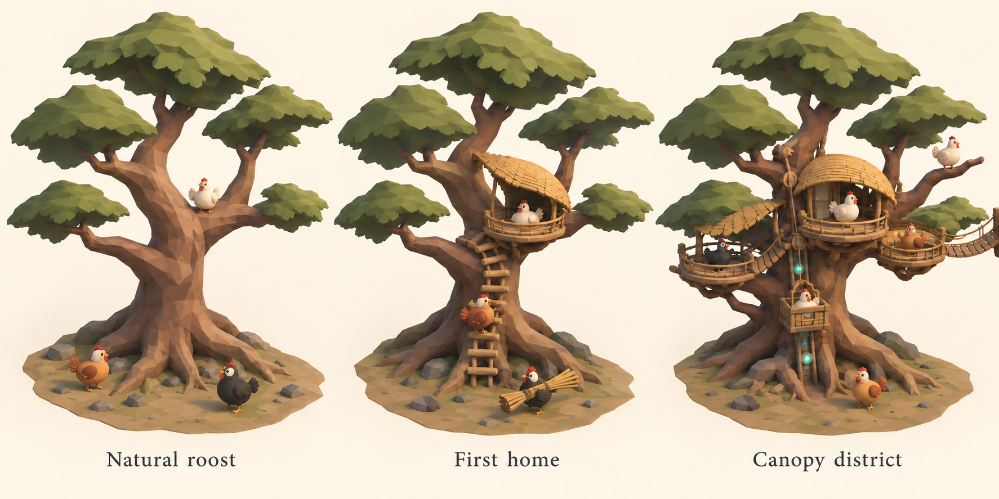
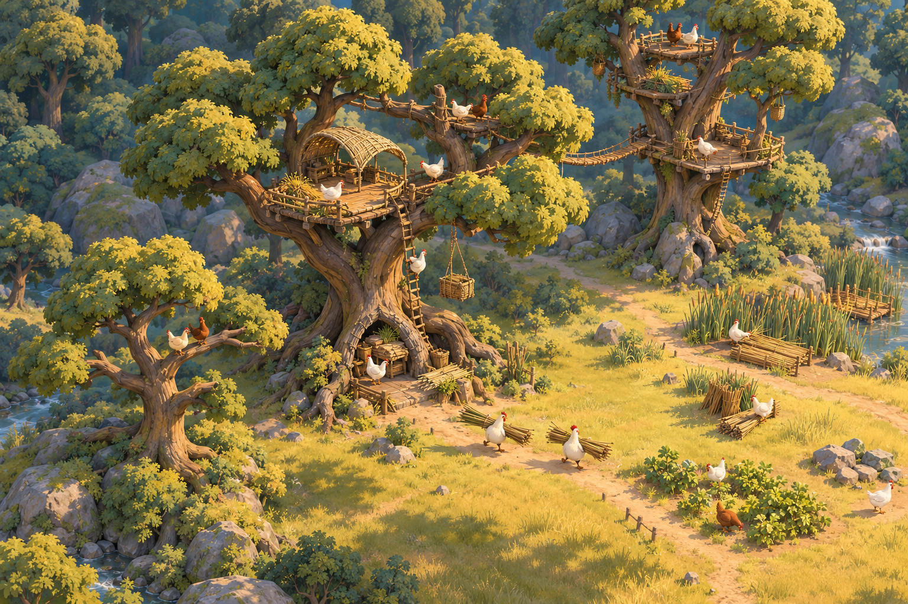
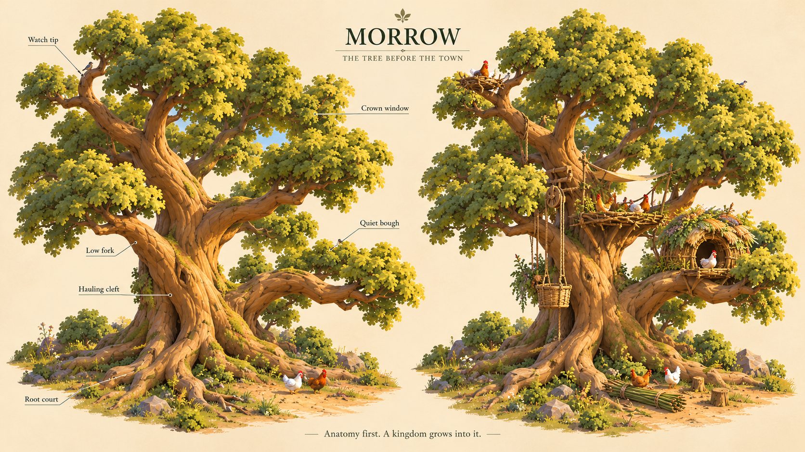
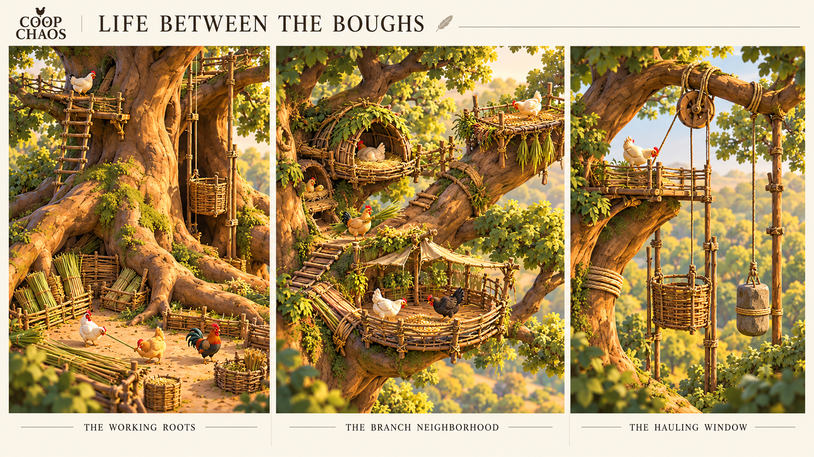
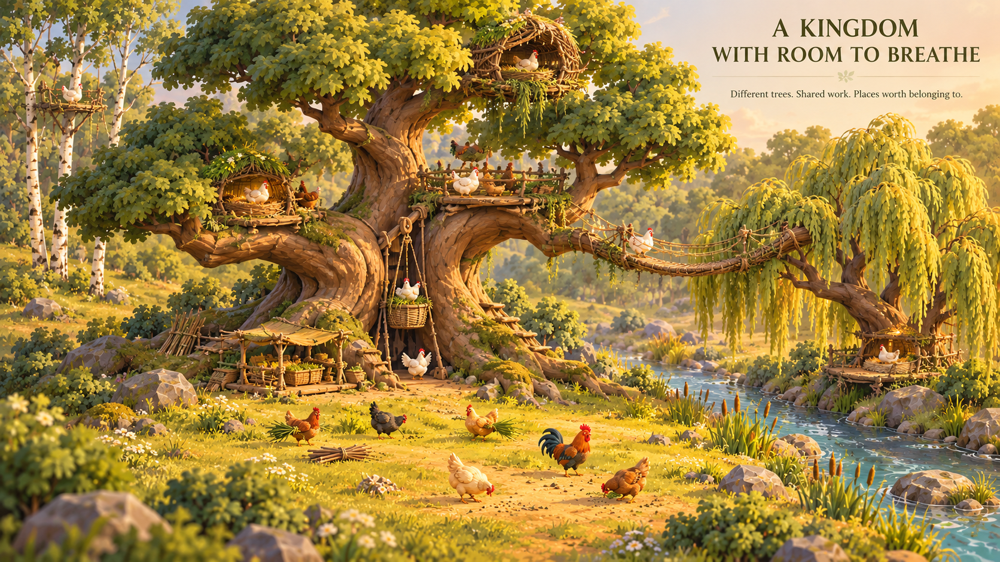
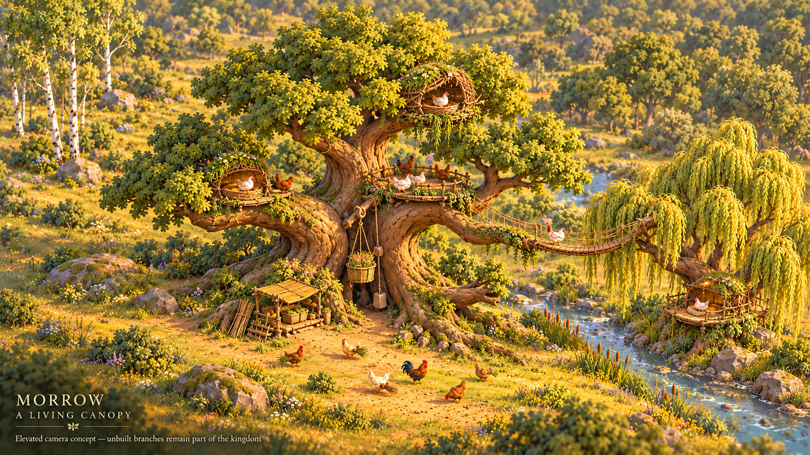

# Trees that become kingdoms

## Brief and status

The user rejected the current tree look on 2026-10-16 and requested a fresh
Astra creative exploration. Existing cone forests, simple crowns, straight
trunks, proportions, and attachment geometry are not visual constraints or an
approved direction. The functional construction proof remains useful for testing
logistics; it does not establish the desired art.

The user accepted this visual direction after the fresh exploration. Three
retained concept boards and a foliage refinement guide the next asset proof;
acceptance does not make their exact forms or contents finished runtime art. These images are generated concepts, not game
screenshots, finished meshes, performance evidence, or implemented technology.
The [settlement design](../story/settlement-design.md) owns gameplay truth;
[technology](../story/technology.md) develops future inventions.

**Design thesis: an unbuilt tree should already suggest the chicken kingdom it
could become.** Its anatomy offers places to gather, rest, load, build, watch,
and escape. Construction makes those possibilities usable and personal.

## Three growth forms

| Direction | Shape and emotional character | Settlement opportunities | Design pressure |
| --- | --- | --- | --- |
| **Longbough** | Broad, crooked, welcoming; a low muscular fork and spreading horizontal limbs. Feels like a place generations could remember. | First homes, shared branch courts, short ladders, visible loading at the roots. | Several households want the same comfortable fork; expansion needs another bough or neighboring tree. |
| **Crowncourt** | Taller split stems around an open central court; layered, ambitious, slightly ceremonial. | Staggered neighborhoods, trunk transport, multiple landings and eventual lifts. | Height creates transport dependencies and congestion; the most impressive perch is not necessarily the most practical home. |
| **Windward** | Leaning, weathered and directional, with a sweeping crown and sheltered underside. | Forest-edge homes, lookout branches, compact refuges and alternate approaches. | Fewer convenient building surfaces; exposure and the route back into the grove matter. |

These are growth forms within one art language, not botanical families or three
incompatible styles. [Tree kinships](../story/tree-kinships.md) owns species-based
families, individual history and community relationships. A species can express
different growth forms; named trees must retain recognizable individual anatomy.
Do not turn an art label into an ancestry or species rule. **Longbough should lead the next asset prototype.** It explains the
whole premise with the least machinery: a bird can use a branch immediately,
then the community can build a home around that same branch. Crowncourt supplies
later density; Windward gives the edge a recognizable character. These names are
working growth-form names, not biological species, family names or mandatory
kingdom names. The accepted premise makes individual trees characters; precise
personal names and ways to express consciousness remain design proposals.

The first board establishes personality and anatomy. Its individual leaves,
bark detail, railings, and scenic background are too intricate to copy literally
into the normal strategy view. Preserve its branching logic and warmth, not its
surface-detail count.

## The tree's anatomy is the neighborhood plan

**Roots form an arrival court.** A crooked root can frame a loading place, but
the useful approach must remain open. Bundles, waiting carriers, and the foot of
a ladder should be visible together. An attractive root tangle that conceals
every ground job fails the brief.

**The trunk has a distinctive gesture.** Give it taper, an asymmetric lean, and
one memorable fork. Use large changes of direction rather than a cylinder with
small branches glued on. Its silhouette should remain recognizable after homes
are added. Species and growth forms need distinct structural cues, not just recolored crowns.

**Boughs provide actual places.** A broad fork suggests a communal deck. A short
side branch suggests a quiet berth. An outward tip suggests a lookout. Preserve
unbuilt perches between structures. Avoid identical horizontal shelves at evenly
spaced levels; the player should be reading a living tree, not a disguised tower.

**Foliage frames inhabited space.** Build irregular spreading crowns with broad
upper planes, dark undersides, scalloped edges, and deliberate air gaps. Leaves
belong mainly around the outer boughs; they should not form one solid lid over
the work. Reject cones, repeated round blobs, and noisy crystalline triangulation.
A tree must still have a convincing crown when nobody lives in it.

**Each access route has somewhere to arrive.** A ladder ends at a landing, a
hoist has loading and unloading space, and a bridge meets a real branch court.
Keep clear visual separation between a narrow natural perch and a route suitable
for walking with cargo. The eventual simulation must own those capabilities;
the art should make them plausible rather than contradict them.

## One tree, a remembered history

The refined maquette is the more useful asset brief. Its spreading crowns improve
on the first maquette's generic round foliage. Keep the continuous trunk identity,
open branch spaces, chicken scale, and visibly earned access.

1. **Natural roost.** Ground activity, an ordinary sleeping branch, and an empty
   fork that invites imagination. Chickens already fly up; this is a viable
   beginning, not an incomplete building waiting for a purchase.
2. **First home.** A fitted woven floor, low nest-like rim, curved rain hood, and
   gripping ladder. The house follows the branch. It has room to turn, rest,
   and arrive with a bundle. The contributing birds can recognize it as theirs.
3. **Canopy district.** Add adjacent terraces and a connection to another tree.
   Later technology can replace a hauling route with a lift without replacing
   the tree's silhouette or erasing the original home. Old ladders and natural
   perches remain legible parts of its history.

The district panel proposes future technology; it is not the current build.
It also needs a real high-angle asset test: the generated view is too shallow
to prove overhead readability, and some railings and roof slats remain too busy.
The illustration must not become an excuse to ship hidden work or excessive mesh
detail.

## Forest composition, not a collection of ornaments

Build the grove from relationships: a pair of neighboring crowns with an inviting
gap for a future connection, a quieter inner fork, a busy tree at the meadow edge,
and an isolated copse across open ground. Paths should visibly leave cover, cross
the commons, and return to a recognizable trunk court. Grassland needs room to
read as productive open land, not leftover space filled with props.

Vary height, lean, crown width, and spacing in related woodland groups. Do not scatter a
uniform grid of identical trees around three special buildable landmarks. Mature
habitable trees need readable anatomy; saplings and distant woodland can use
quieter rendering without implying a different ownership or safety rule.

The atmosphere board captures the warmth and relation between ground and canopy.
It is still too detailed and close to a cinematic illustration to be a literal
render specification. In particular, its tall rear tree is cropped, its foliage
can conceal work, and its tiny vegetation would compete with chickens at normal
zoom. The final scene must show navigable space more clearly than this painting.

## Shape, color, scale, and motion

Use warm gray-brown or honey bark, deep moss crowns, muted golden open ground,
and cool shaded undersides. Reserve the brightest cream, russet and comb-red
accents for chickens and useful activity. Avoid luminous lime terrain and black
forest walls. Landmarks should stay recognizable in evening light.

Favor sculpted low-poly forms with broad, controlled planes and modest painted
variation. Low-poly does not mean primitive shapes or maximum visible triangles.
Choose a few confident bark ridges and crown lobes. Roofs can borrow the rhythm
of overlapping feathers; platforms can feel woven and nest-like without turning
every object into an egg. No human cottage pasted onto a branch.

Provisional modeling proportions use a chicken's body width as the ruler: a
natural perch accommodates one bird, a landing offers turning room for a carrier,
and an early deck reads as a place for roughly three or four birds. These guide
visual scale, not implemented capacity numbers. Feet must meet the perch; heads
must clear the shelter; cargo must fit through access. A platform's occupants
cannot be an unreadable cluster of dots.

Use restrained wind motion in outer foliage. Load-bearing limbs, ladders, and
occupied decks should not sway independently of their occupants. A lift's travel
must explain its current work; movement is not decorative proof that a job ran.
Reduced motion preserves task and route information.

## Visibility is a design requirement

Compose each first asset for the actual elevated strategy camera before close-up
polish. At ordinary zoom, a player should distinguish natural roost, unfinished
home, occupied home, ground arrival, and upward route. Selection may soften only
the crown sections obscuring the selected work, retaining enough silhouette to
locate the tree. Do not hide the entire forest whenever a bird is selected.

Test a single tree, then a cluster of three, then the cluster at wider settlement
zoom. Prevent neighboring crowns from concealing all routes between them. Labels
can clarify identity but cannot rescue an unreadable mesh. Keep path/build previews
selectable where leaves overlap them; visual occlusion and navigation are separate
problems.

## Next asset proof

Create one Longbough model with authored branch anatomy, separated crown pieces,
natural perch positions, ground arrival, and a compatible first-home module.
Use the existing functional construction simulation to exercise it; do not add
food, territorial politics, or advanced technology merely to showcase art.

The first acceptance scene needs an unbuilt and built version side by side at
the real camera, visible ground-to-branch travel, actual occupancy, a carried
bundle, daylight and evening, and a three-tree overlap case. Then test a narrow
viewport and a wider settlement view. Confirm usable picking and performance on
an identified device; concept art does not establish either.

Blender/GLB meshes and Babylon rendering remain compatible with this direction.
Exact polygon, texture, and draw-call budgets should follow the first measured
cluster. Reuse materials and modular construction parts without flattening every
tree into the same silhouette. Do not remodel the whole forest before this one
tree earns its place.

## 2026-10-18: provisional anatomy and infrastructure exploration

These four new images explore beauty and inhabitation, without superseding the
accepted targets or establishing runtime-art acceptance. The anatomical board
and construction details are the strongest direction: a rooted sculptural trunk,
continuous tapering limbs, uneven branch neighborhoods, crown windows, and
unbuilt places that remain valuable in their own right.

Roots supply a working court; a low branch offers accessible homes; a broad
middle fork invites communal work; a quiet upper nest keeps its distance. A
clear lift shaft sits outside the wood. Neighboring species invite construction
suited to their different limbs, rather than copies of the oak's buildings.
These are proposed spatial relationships, not new building rules. **Morrow is a
proposed character name; saved Lowfork is not renamed.**

The atmosphere image crops the crown and uses too low a view. Its passenger
basket is not part of the current game. The refined composition below is a more
useful full-tree illustration, but neither image proves the actual fixed camera,
readability, routes, or performance.

All four are aspirational generated concepts. Additional nests, communal decks,
bridges, counterweights and other depicted infrastructure are not implemented
mechanics; the current material-hauling basket and sleeping extension remain
bounded by the [settlement design](../story/settlement-design.md). Generated
ropes, anchors and load paths require coherent mechanical modeling and access
routes before implementation.

The built-in image generation tool used
[opening-view-v2](concepts/opening-view-v2.png) as its style reference.
[Exact prompts and refinement instructions](concepts/tree-infrastructure-prompts.json)
are retained unchanged. These PNGs are concepts, not shipped runtime assets.

## Earlier exploration provenance

The earlier growth-form, progression and grove boards are saved in this repository. They were created with
the built-in image generation tool; no existing runtime screenshot was used as
the starting reference. The final progression board refines the generated first
maquette. [Exact prompts and refinement instructions](concepts/prompts.md) are
retained alongside the images. None of these PNGs is a runtime tree asset.

### Inhabited-tree implementation comparison

The bounded runtime proof replaces Lowfork’s leaf-heavy, mostly coplanar branch
rods with continuous unequal forks, an open ground workcourt and a reserved
cargo cleft. Open home and deck rainhoods expose the actual sleeping occupants.
The upper deck route climbs the existing ladder, crosses the home edge and
connecting ramp, then reaches its berth; construction work approaches a nearby
ground cell instead of the trunk center. All six saved berth endpoints remain
unchanged. The three playable trees intentionally share one habitat profile;
this does not implement species-specific capabilities.

Matched fixed-camera evidence is retained in the ignored
`output/playwright/tree-comparison/` qualification bundle: baseline
`fresh-day-world.png` / `built-evening-world.png`, and revised
`final-fresh-day.png` / `final-built-evening.png`. Its manifest identifies exact
source, asset and image hashes. These are actual Babylon frames; the generated
boards above remain aspirations. Handcrafted terrain richness, more varied
secondary anatomy and the concept’s full tree-neighborhood detail remain open.
No tree-food, shade, or predator outcome was introduced by this anatomy proof.

### Size-first spatial tree study

The next bounded implementation authors larger trees in true metres: Lowfork
about 11m high with a 14m-wide, 8m-deep crown, Splitcrown about 9m / 10m / 7m,
and Reedside about 8m / 9m / 6m. These are authored branch architectures, not
scaled rooms. Adults use canonical .365 presentation scale, about .55–.66m
high; the first actual home and sleeping deck retain two commissioned berths
each. The canonical six foot sockets and current hauling/access transforms
remain unchanged. Each tree keeps natural roost continuations, open crown
windows, a front working court and its low working saddles.

Lowfork's separate occupied planning fixture tests four future six-resident
households on actual forks, with staggered elevations and orientations. The
clear sleeping floor is 2.4 × 2.2m rather than the initial 2.4 × 1.8m envelope:
complete adult bodies and tails need the added depth. Two 1.5m perches, a .65m
side aisle, .9m headroom and a separate 1.5 × .9m turning landing are measured separately.
The lower home neighborhood expands onto a neighboring fork; its old floors
become shared work landings, without uncounted extra bedrooms. Proposed service
walkways, landings, a distinct first-stage hoist and climb provision establish
an access study, not implemented construction or movement rules.

The labeled opening and mature source renders, original Blender fixtures and
actual-mesh packing/clearance receipts are described in
[the tree asset provenance](../assets/sculpted/trees/README.md). The mature
cutaway omits foliage and shelter roofs so occupants and
usable floor can be inspected; the normal source proof retains opaque foliage.
Twenty-four Lowfork, sixteen Splitcrown and twelve Reedside residents are future
habitation planning targets, conditional on food, water and care, not biological
carrying capacity or numeric load claims. Splitcrown/Reedside mature interiors
are not occupied proofs in this slice. Current gameplay capacity is unchanged.
Source checks do not replace runtime acceptance of grove overlap, lighting,
route traversal and saved identity.

## Isolated natural-tree runtime comparison

The 2026-10-26 tree study revisits Longbough, Crowncourt and Windward as natural,
unbuilt forms, using the Chicken Civ scene concept and the anatomy principles
above. This is an art comparison, separate from playable valley geography and
woodland habitation. Growth-form names establish neither species nor ancestry,
capacities, homes, work rules or predator safety.

The initial title-screen **Tree art study** reused the accepted valley surface, lighting,
fixed camera angle and adult presentation scale. Four static foreground chickens,
one carrying reeds, supply a consistent gauge. Each tree occupies the same
render-only grounded origin. **Whole tree** fits the union of all three actual
asset bounds and the foreground fixture, preserving equal comparative framing
on wide and narrow screens. **Chicken scale** uses the valley's tactical 4.2m
vertical halfspan at the roots. Neither view rescales trees. **Show branches**
hides foliage explicitly for anatomy inspection; this is not a gameplay
occlusion solution.

Editable sources, export validation and provenance live with the
[isolated tree assets](../assets/sculpted/valley-trees/README.md).
[Runtime evidence](../output/landscape-qualification/tree-exploration-v1/README.md)
records revision-specific screenshots and checks. Studio renders and source
bounds alone do not establish actual-camera quality. The three v5 silhouettes
are accepted for this isolated exploratory comparison. Broad bark treatment and
support-lobe rhythm remain prototype limits; no form is finished game art.

## Longbough building-scale study

The user supplied a closer inhabited-tree reference on 2026-10-26 and requested a
larger tree that can visually accommodate buildings. The isolated Longbough study
therefore explores a thicker forked trunk, a fuller crown, three staggered fitted
deck massings, one woven shelter and visible ladders, rails and a hoist. These are
static scale and architectural studies, not construction, access or occupancy
rules. Crowncourt and Windward remain natural comparison forms.

Longbough opens in **Inhabited detail**, with **Show structures** on. **Whole tree**
restores crown and ground context; **Chicken scale** retains the existing ground
gauge. All adults keep the same .45625 presentation scale. Additional static
figures stand at the asset owner's measured deck floors; camera framing never
rescales birds or tree geometry. **Show branches** remains explicit foliage
inspection. Structure visibility is meaningful only for Longbough.

Inhabited detail hides the four ground gauges so its close framing shows only
complete deck figures. Whole tree and Chicken scale retain all four ground
gauges. Hiding structures also hides their staged occupants. The scalar .45625
is the existing adult presentation transform, not a claimed biological height;
actual body heights and supported feet are measured in the runtime evidence.

The asset owner retains the reference provenance, editable sources, measured
floor fixture and export evidence with the isolated assets. Runtime screenshots,
actual support/clearance checks and prototype limitations belong to
[building-scale qualification](../output/landscape-qualification/tree-habitation-v1/README.md).
No dimension in this study establishes capacity, species, ancestry, structural
engineering or usable ladders, hoists or habitats.

## 2026-10-27: Longbough art refinement

The user rejected the preceding v4 inhabited tree's visual fidelity on 2026-10-27.
Its earlier acceptance was limited to a functioning building-scale prototype;
it does not establish approval of that art or a close reference match. The
preserved v4 source and evidence remain historical.

The new v8 isolated study has a continuous tapering ridged fork, fuller layered
leaf sprays, rounded timber balconies fitted into branches and smaller open
woven props. This revision omits the former shelter roof. Original valley-kit
mineral stones and moss ground the root dressing. The [editable source and
provenance](../assets/sculpted/valley-trees/REFINEMENT.md) retain measured floors,
fixtures, rejected source diagnostics and reproducibility proof.

The study uses a raking warm key, cool fill and softened contact shadows to reveal
bark and sheltered forks. Only Inhabited detail lowers the camera pitch to beta
1.10; Whole tree and Chicken scale keep their established angle. Matched-camera
comparisons distinguish mesh and material changes from this framing change.
Adults and attached cargo retain .45625 presentation scale. Playable valley and
woodland lighting, geography, routes and save semantics are unchanged.

Primary runtime review accepted a substantial visible improvement in the
[final actual-camera evidence](../output/landscape-qualification/tree-art-refinement-v2/README.md).
It remains stylized study art: repeated rounded foliage shoulders, simplified
joins, broad root grain and faceted stone mottling need further craft. This is
not an exact reference match or finished game art. A single 18.85 MB hero study
does not establish a forest rendering budget, usable capacity, structural
strength, circulation or functional access.
