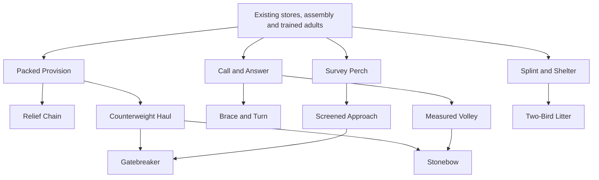

# Chicken Civ: the Long Crow

Technology, careers, command and succession · 24 October 2026 · Design draft 1

**Status:** the user requested a detailed, creative progression design anchored in
StarCraft and chicken lore. Warfare and territorial conquest remain the accepted
goal. All names, institutions, unlocks, thresholds and costs below are proposals,
not implemented systems or accepted balance. This document extends the
[gameplay design](chicken-civ-design.md), [narrative design](chicken-civ-narrative.md)
and [technology direction](../technology.md). Existing saved games are unchanged.

## 1. The promise: a flock learns to become a kingdom

At first, six chickens shouting from a branch consider themselves an army.
Later, the same grove can dispatch a supplied expedition, teach a practiced
withdrawal, build a counterweight engine, and remember whose ingenuity made it
possible. The player should see civilization accumulating in useful places and
recognizable people. A marvelous machine arrives with a new military possibility
and a decidedly less marvelous demand for operators, supplies and protection.

The proposed name **the Long Crow** describes a kingdom's growing reach: how far
its warning, promises, provisions and armed presence can actually extend. It is
a cultural expression, not another resource meter or literal global sound range.

Three progressions run together:

| Progression | Belongs to | Earned through | Does not grant automatically |
| --- | --- | --- | --- |
| Shared techniques | A coop's retained knowledge | Supplied trials, demonstrations, teaching | Free equipment or buildings everywhere |
| Personal expertise | A named chicken in a discipline | Training and useful service | Political office, universal combat superiority |
| Responsibility and standing | Appointments and specific relationships | Delegated duties, witnessed conduct, support | Competence, inherited obedience, ownership of others |

Separate these from biological age. Becoming an adult makes an individual
eligible for adult work, not a trained soldier. Becoming old does not guarantee
wisdom or office. Tree family, sex and ancestry never lock a profession or tier.

## 2. Research anchors and the deliberate departures

StarCraft's Forge joins a physical prerequisite to several shared upgrades and
defensive construction. The general lesson is that a tech investment can reveal
a commitment and compete with producing fighting strength now. Chicken Civ should
make that commitment visible in a workshop, its workers and delivered stock.
[Blizzard's original Forge guide](https://classic.battle.net/scc/protoss/popup/forge.htm).

StarCraft II's co-op design separately gives commanders experience across missions
and unlocks units or abilities as their level rises. Its historical mastery system
adds configurable powers after commander leveling. That is a different layer from
the economy and construction of a particular battle. Chicken Civ should explicitly
separate scenario preparation from persistent careers; importing all these rewards
into a single generic level would obscure what the player earned and what a rival
can counter. These are historical mode descriptions, not current balance claims.
[Co-op introduction](https://news.blizzard.com/en-us/article/19930660/legacy-of-the-void-features-co-op-missions),
[mastery introduction](https://news.blizzard.com/en-us/article/20112699/patch-3-3-new-co-op-content-and-features).

The wider investment, distance, production and counterplay evidence remains in
the [StarCraft study](chicken-civ-starcraft-gameplay.md). Individual civilian
careers, local cargo, embodied invention and political succession are Chicken Civ
proposals, not claims about standard StarCraft mechanics.

Chicken behavior supplies useful inspiration for calls, recognition, roosting,
foraging and relative social standing. It does not supply a natural constitution.
The [biology research](../../docs/research/chicken-biology.md) already distinguishes
observed behavior from personification. The councils, military schools, archives
and succession customs below are invented chicken culture. Neither hens nor
roosters have a biologically assigned monopoly on command or care.

A 2016 experiment found hens distinguished familiar males after different
experiences of their food-related displays. This provides a narrow inspiration
for remembering whose signals proved useful; it does not establish political
loyalty. A 2018 food-finding experiment found following preferences after paired
training but not trio training. That contextual result argues against treating
successful foraging as an automatic, universal leadership promotion. Chicken Civ
deliberately invents the more elaborate social interpretation.
[Smith and colleagues, 2016](https://pubmed.ncbi.nlm.nih.gov/26915426/),
[Wichman, 2018](https://www.frontiersin.org/journals/veterinary-science/articles/10.3389/fvets.2018.00234/full).

## 3. The ladder: three military horizons and a distant fourth

| Horizon | Plain-language equivalent | What the player becomes able to do | What remains dangerous |
| --- | --- | --- | --- |
| **First Muster** | Assemble | Equip a small force, scout, raid and contest a nearby grove | Every mobilized adult is a large share of the workforce |
| **Long Reach** | Sustain | Supply a longer expedition, rotate guards, coordinate specialized action | Routes, operators and relief commitments can be attacked |
| **Broken Gate** | Breach | Defeat prepared works and open a defended approach | Slow expensive equipment needs crews and an escort |
| **Sunlit Canopy**, later | Powered civilization | Operate powered access, cargo and protective infrastructure | Energy, maintenance and chokepoint dependencies |

These are groups of dependencies. No age-up button completes every branch, and
no elapsed timer advances the kingdom. A compact First Muster army can defeat a
poorly protected engineering project. Long Reach can win through maneuver without
building siege. Sunlit Canopy belongs to a later campaign and retains the existing
Sunscale/Featherlift proposals; its energy model is not specified here.

There are four branches: **Provision**, **Warcraft**, **Fieldcraft**, and **Care**.
They share workshops and adult time, and occasionally require one another. Care
means returning people to useful life; it does not become a magical healing aura.
Fieldcraft includes observation and engineering, not a separate collectible ore.

## 4. What an unlock actually means

Each technique has four states: **conceived → in trial → demonstrated → taught**.
The first player can inspect all branch goals from the start. Scouting and work
can highlight a useful idea, but deliberate planning never requires suffering a
casualty or manufacturing a shortage to make the button appear.

The player chooses a trial at a **Knotyard**, the proposed name for the assembly
and experiment ground. One trial occupies its work slot and a named trained adult;
research time competes with equipment production there. Another Knotyard buys
parallel capacity at a proposed 6 reeds, 2 stone and 60 seconds of adult building
work. It does not supply the second researcher or their materials.

Trial costs in the table below include the first prototype or practice apparatus.
Materials are delivered and consumed during actual work. The listed time is
effective work at 1×, excluding travel and meals. No additional prototype is
created at completion: the existing trial object becomes the first usable copy
when demonstrated, unless that demonstration explicitly consumes it. Consumables
used during a trial remain consumed and must be made again for field use. Later equipment copies cost their listed material bill again,
with the listed assembly work, but need no repeated discovery. Drill apparatus
is infrastructure, not equipment replicated onto every soldier.

A useful demonstration completes the discovery; the interface states the test
before committing resources. Safe practice targets and rehearsals are legitimate.
Failed or interrupted trials retain their actual object, ingredients and progress.
Cancellation cannot refund consumed material and also retain the prototype.

Shared knowledge unlocks production recipes. **It never upgrades carried equipment
at a distance.** A drill additionally needs participating adults to practice it.
An equipped upgrade additionally needs a physical item delivered and fitted at
the appropriate workshop or muster court. Destroying a workshop stops production;
it does not erase learned knowledge. Losing the only expert can slow teaching,
but does not make a documented invention cease to exist.

Demonstrated records the discovery and its method in retained coop knowledge.
Taught records the first other adult completing the required fitting or practice;
it is useful history, not a second global recipe-unlock gate. Later participants
must still complete their own fitting or practice. A solo inventor's death cannot
erase a demonstrated technique from the saved knowledge record.

## 5. Initial technique catalog

R = reeds; S = stone. All bills and times are provisional. Ordinary kits, food,
the muster court and basic field stores already defined in the gameplay proposal
remain available without these upgrades. Food provision, retreat, scouting and
first aid must work before specialization. No new raw resource is introduced.

| Technique | Prerequisite | Trial bill / work | Demonstration and useful result | Cost or counter |
| --- | --- | --- | --- | --- |
| **Packed Provision** — Provision, First Muster | Basic local food store | 3R + 1S / 45s | Fit and deliver one balanced ration load; a fitted pack holds 25% more food by volume | Loaded wearer is 10% slower than its otherwise applicable loaded speed; no ammunition capacity bonus |
| **Call and Answer** — Warcraft, First Muster | Muster court | 2R / 30s | Two adults rehearse an ordered withdrawal and regroup; unlock a squad withdrawal drill | Both spend 15s practicing; it coordinates destinations, not global vision or instant movement |
| **Splint and Shelter** — Care, First Muster | Recovery shelter | 3R + 1S / 45s | A caregiver practices with a willing uninjured partner; fit a field splint kit | One kit can add 20s to one casualty's remaining stabilization window, once per casualty; applying takes 5s without attacks and consumes the kit |
| **Survey Perch** — Fieldcraft, First Muster | Safe reachable observation position | 3R + 1S / 45s | A watcher observes a marked approach from the actual perch; staffed installation gains two ground cells of sight along clear lines | Stationary adult and real access; no sight through cover and no generic tree-species bonus |
| **Relief Chain** — Provision, Long Reach | Packed Provision and a working field store | 4R + 1S / 60s | Complete one depot handoff; enable a standing delivery-and-return assignment with explicit stock targets | Carriers and reserves still required; automation creates neither supply nor safe routes |
| **Counterweight Haul** — Provision/Fieldcraft, Long Reach | Existing basket technique and stable anchors | 6R + 3S / 90s | Raise an actual construction load; larger rig moves two standard bundle loads per cycle | One operator, loading space and supported anchors; cannot extend across arbitrary map distance |
| **Brace and Turn** — Warcraft, Long Reach | Call and Answer | 3R + 1S / 60s | Two Guards practice holding and pivoting together; coordinated pivot keeps the existing frontal protection while stationary | No extra armor; requires both participants' practice, clear occupied spaces, and only protects the facing arc |
| **Measured Volley** — Warcraft, Long Reach | Call and Answer, two trained Slingers | 3R + 2S / 60s | Two Slingers each release two real stones at a practice target; synchronize release onto one selected target | The four practice stones are additional ammunition, explicitly consumed; ordinary target/impact rules apply, with no area damage, free ammo, range, damage or firing-rate increase |
| **Screened Approach** — Fieldcraft, Long Reach | Survey Perch | 4R + 2S / 60s | Build and use one screen section in a movement rehearsal; blocks ranged line of sight through its occupied cells | Blocks friendly shots too; attackers can flank or destroy the work; no universal protection bubble |
| **Two-Bird Litter** — Care, Long Reach | Splint and Shelter | 4R + 1S / 60s | Two carriers move a willing practice passenger; later evacuate one casualty together at ordinary loaded walking speed | Occupies two adults, neither fights while carrying; no stabilization until care is applied |
| **Gatebreaker** — Fieldcraft, Broken Gate | Counterweight Haul and Screened Approach | 8R + 4S / 120s | Crew tests a beak-released falling counterweight against a practice panel; attacks installed military works | Two operators, contact range, deployment and vulnerable approach; cannot target people or living trees |
| **Stonebow** — Warcraft/Fieldcraft, Broken Gate | Counterweight Haul and Measured Volley | 10R + 6S / 120s, plus 2S demonstration ammunition | A crew fires a tension-driven stone cup at a practice work; long-range siege against an installed structure | The first trial requires 8S total: 6 in construction and 2 spent on its test shot. Later machines cost 10R + 6S, with ammunition always separate; two crew, minimum range and slow reload leave them vulnerable to Raiders |

The existing basket invention is a prior knowledge dependency, not a demand to
repeat its discovery in every fresh battle. A scenario declares whether it starts
known. If it is unknown, its existing delivered-load demonstration remains the
route to learning it. First Muster is viable without a basket or siege.

Kits are fitted individually; learned drill variants can be practiced by any
suitable trained adult, without a Veteran-only gate. A veteran learns execution
specialties below, while ordinary trained troops retain all basic counters.

For the first upgrade experiment, include only Packed Provision, Call and Answer,
and Splint and Shelter. Test the base conquest loop before adding the rest. This
catalog describes the intended ladder, not twelve systems required for the MVP.

## 6. Siege that feels invented by chickens

The **Gatebreaker** is a low woven frame with a suspended stone bundle and a
toe-braced release. Its crew worries about the approach, the counterweight and
who gets to pull the extremely ceremonial cord. It is a labor commitment, not
a gigantic chicken with inflated health.

The **Stonebow** uses a flexible frame and a stone cup, released by a beak lever.
That mechanism is fictional and requires anatomical and visual design before
production. Its initial tuning hypothesis is 6-cell maximum range, 2-cell minimum,
10s deployment, 12s reload, and two stone units consumed per shot. It targets
installed military structures only. Proposed structure damage is 60 per resolved
shot; it has no anti-personnel splash or automatic homing. The Gatebreaker proposes
40 structure damage per 6s cycle after 8s deployment at contact range.

Both require both crew members to operate. A missing crew member stops the next
cycle; withdrawal or redeployment takes real movement. Early structural testing
can use a 180-integrity screen and 240-integrity military post as explicit test
targets. These are new military fixtures, never health assigned to living trees
or a retroactive destructibility rule for the current homes. A disabled post
does not grant territory: capture, staffing and supply remain necessary.

Three Stonebow hits would disable that screen, requiring six stone units, correct
position and uninterrupted operation. That arithmetic gives a testable siege
window; it does not prove the operator economy or full matchup is balanced.

## 7. Opportunity cost and readable openings

A new technique must buy a decision the player can describe. “My carriers can
support the far grove,” “my guards can rotate toward the flank,” and “I can break
that barricade” are useful milestones. A succession of invisible percentage
increments would be a weak primary ladder.

Keep three separate clocks visible: travel to deliver inputs, effective trial
work, and fitting or rehearsal before use. A scout who sees a Stonebow trial
knows a siege threat is developing, not that an invisible upgrade has already
buffed every enemy. An incomplete rig, occupied workshop and moved stone stocks
provide clues only when actually observed.

For a protected investment, approximate payback as material/work opportunity
cost divided by the extra useful throughput it enables. Do not confuse this with
an exact win timer. For example, Packed Provision's 25% capacity and 10% loaded
speed penalty do not guarantee 25% more throughput: trip geometry, empty returns,
loading time and worker availability determine the result. A short route may
justify no pack at all. A long dangerous crossing may reward it strongly.

| Plan | What it buys first | Window of weakness | Rival answer |
| --- | --- | --- | --- |
| Early pressure | More prepared adults and ordinary kits | Smaller economic workforce and thin reserves | Defend cheaply, preserve carriers, then counterattack |
| Long expedition | Packs, relief deliveries and a forward store | Materials and people committed before the force arrives | Raid the supply or attack a lightly held home approach |
| Prepared defense | Watch position, practiced Guards, screens | Static investment cannot occupy distant objectives by itself | Scout another approach or develop siege under protection |
| Siege commitment | Engineering, crews and ammunition | Fewer mobile combatants while the machinery is prepared | Strike early, flank the crew, remove ammunition access |

The rival follows the same resource and knowledge rules. A prototype can script
its initial choice, but meaningful strategic qualification requires responding
to observed commitments. Knowledge of every player research queue is cheating.

## 8. Character disciplines and four levels

Six disciplines are sufficient: **combat, scouting, logistics, craft, care and
leadership**. An individual can retain learning in several, but practices one
primary discipline during a particular duty. One event cannot grant six awards.
Military roles are equipment/assignment choices within combat; they are not
separate species, inherited classes or irreversible professions.

| Level | Requirement, proposed | Capability |
| --- | --- | --- |
| **Learner** | No completed instruction in that discipline | Ordinary civilian work; supervised specialist preparation |
| **Trained** | Complete instruction and its practical demonstration | Perform the discipline's normal specialist work |
| **Veteran** | Trained, six qualifying service marks, at least two kinds of relevant service | Choose one discipline specialty |
| **Master** | Veteran, eighteen total marks, service in at least six completed scenarios, and one successfully taught adult | Use two specialties in that discipline simultaneously and teach advanced practice; no blanket army aura |

Combat training retains the gameplay draft's 45s at a supplied muster court.
For the other disciplines, initially test 45s of effective mentor-led instruction
plus one real task. An authored scenario can start with trained residents so the
economy does not wait for every worker to attend school. Ordinary gathering,
movement, care essentials and self-preservation are never disabled by an empty
experience bar. Advanced practice can be learned from retained instructions
without a living master, at a proposed twice-normal training work cost.

A service mark is a record of a useful completed duty, not spendable currency.
Examples: a delivery received against an existing need; a construction stage
completed; an assigned reconnaissance approach newly observed; a supplied guard
rotation completed; or a recovery stage completed with actual care. Mark events
need the participant, duty, place, outcome and simulation time.

Award at most one mark per adult per discipline in a four-minute cycle, and at
most three marks per adult per scenario across all disciplines. A single duty
outcome contributes once; splitting or canceling a job does not create another
outcome. Empty return travel, allied staged injuries, friendly attacks, empty deliveries,
repeatedly scouting the same unchanged ground, and kill stealing earn nothing.
Failed battles can still contain a useful completed escort or rescue. Masters
therefore belong to longer campaigns, not a twenty-minute grind within one map.

Publicly show “Veteran: 4 of 6 service marks; needs a second kind of service”
with the actual incidents. Do not show a mysterious bar whose fastest strategy
is deliberately wasting time. Exact thresholds need testing against scenario
length; the core principle is useful participation rather than farming victims.

## 9. Specialties and meaningful level-ups

No automatic health or damage gain accompanies a level. A Trained adult has no
specialty slot, a Veteran has one in that discipline, and a Master has two in
that discipline. A specialty applies only to its stated action and equipment;
collecting expertise in other disciplines does not multiply the same benefit.
As a starting constraint, combined personal percentage benefits to a given work
or attack-timing category cannot exceed 10%. Explicit capabilities such as an
extra sight cell or a guarded backward step use their stated conditions instead;
equipment and positional rules remain separately visible.

Changing a slot needs 30s of safe practice at the relevant workplace; it cannot
be swapped in combat. The new choice replaces that slot's active effect. Previously
practiced alternatives remain known but supply no benefit while inactive. A Master
can use both active choices together only when both conditions actually hold;
the percentage cap still applies. Changing duties does not silently select an
optimal specialty loadout. The first prototype needs only one explicit Veteran
slot, while multi-discipline Master loadouts belong to the later campaign.

| Discipline | Example Veteran choice | Different choice | What the level never grants |
| --- | --- | --- | --- |
| Combat | **Rearguard:** an equipped Guard may defend while backing away at half normal speed, facing the threat | **Steady Sling:** 10% shorter aim portion of the shot cycle while stationary | Extra ammunition, firing while retreating, invulnerability |
| Scouting | **Groundreader:** inspect a recent trail to estimate passage and direction | **Still Watch:** one extra cell of sight after 5s stationary with clear sight | Live tracking through fog or knowledge of intent |
| Logistics | **Surefoot:** 10% faster loading/unloading | **Return Planner:** automatically choose a useful return load from permitted observed needs | More stock than exists, global pickup or safe-route guarantees |
| Craft | **Field Repairer:** repair known military work in the field using actual materials | **Jigkeeper:** 10% less effective assembly time for practiced recipes | Free repairs or discovery of unrelated technologies |
| Care | **Splintkeeper:** apply an available splint kit in 4.5s instead of 5s | **Recovery Guide:** 10% less effective recovery work when personally caring | Instant healing, revival, unlimited extension of stabilization |
| Leadership | **Relief Keeper:** automate a declared rotation once replacement and supply conditions hold | **Measured Rally:** coordinate a practiced regroup around a chosen safe point | Obedience from unwilling people, teleportation or a stat aura |

Groundreader requires recorded passage evidence with a finite lifetime. It is
deferred until such evidence exists; a decorative footprint cannot reveal secret
enemy state. Leadership automation performs legal ordinary actions the player
can already order manually. It makes a trusted officer useful without locking
basic retreat or command behind leveling. Returned cargo never overrides an
urgent original delivery or another worker's reservation.

Each rank-up offers a small moment: choose the specialty, see the deeds that
earned it, then return to play. Celebrations wait until immediate combat ends.
Names, titles and a freely given woven feather-knot can change; bodies do not
magically grow larger. Personal reputation depends on witnesses and relationships,
not automatic global acclaim whenever a level increments.

## 10. Hierarchy: command, craft and the pecking order

The player continues to guide the coop council. Offices delegate a bounded job;
they do not place an immortal player character on the map. For the twelve-adult
scenario, use one captain and, when useful, one quartermaster. District government
belongs to a larger campaign. Each office holder takes real time away from other
work, and an office without an actual responsibility provides no buff.

| Office and proposed ceremonial title | Authority | Practical cost | Replacement rule |
| --- | --- | --- | --- |
| Squad captain, **First Wing** | Coordinate one squad, initially up to four members including the captain | Leads in the field; cannot simultaneously supervise home production | Named willing deputy can inherit the assignment |
| Quartermaster, **Keeper of the Second Supper** | Set authorized expedition stock targets and delivery priorities | Must work at the relevant depot for its automatic dispatch cycle | Local workers continue saved jobs if the keeper leaves |
| Grove steward, **Branchwarden** | Coordinate one holding's agreed work, relief and provisions | Limited to that holding; competes with personal craft time | Council appoints an acting steward; existing obligations persist |
| Council convener, **First Call** | Represents the community's chosen campaign commitments | Political responsibility and specific promises, not a combat aura | Council continues if the individual dies or loses office |

Four is an initial managed-squad size, not a hard limit on directly selecting or
commanding more adults. More squads require more people and attention, not
invented command mana. A large force is useful before it has perfect officers.
One adult may hold a home title and field title, but cannot perform incompatible
jobs at the same time; preflight shows the uncovered duty.

The local **pecking order** records who tends to yield to whom in familiar social
contexts. It is a directed relationship, not a universal leaderboard. Separate
it from appointment, skill and trust. An intimidating veteran may get the best
perch while an unassuming hen commands the supply chain. Essential meals and
care cannot be silently withheld by a rank formula; any contested access needs
an explicit local rule and visible consequence.

Advancement creates several satisfying destinations. A master weaver can remain
a craftsperson, teach others and refuse office. A captain can return to ordinary
life. A council member can be inexperienced in battle. Neither sex nor family
dictates which path is available.

## 11. Appointment, failure and succession

An appointment shows the duty, candidate's relevant learning, willingness, current
work displaced, named deputy and known relationship conflicts. The player can
appoint a willing inexperienced leader, accepting the missing expertise. Offices
do not need a popularity score to function. A known refusal is visible before
confirmation; surprise disobedience requires an actual changed condition.

If a captain falls, remaining troops retain their orders and skills. They do not
lose health, vanish, or freeze. A willing designated deputy assumes the existing
authority. Otherwise the player controls the squad directly until appointing a
replacement. Coordinated actions pause if their actual operator is missing, not
because every subordinate forgot how to move. Recovery and relief stay urgent.

The proposed campaign custom is the **Empty Perch**: the council leaves the dead
or absent office holder's place empty during the first gathering after a loss.
The deputy already handles necessary work. At a quiet transition, the player
chooses among willing candidates; no election popup interrupts a battle.

A succession scene may present competing claims: previous designation, practical
competence, contribution, or the support of particular households. Record which
claims were honored and who expected otherwise. Disappointment can change a
specific future agreement; it does not automatically trigger rebellion. Full
coups, voting systems and civil war require later design and are not implied.

First Call is an office, not the win condition. Its holder's death does not end
the game; military defeat still follows the gameplay rules. Removing a leader
preserves their expertise and history. Their replacement inherits outstanding
institutional promises, not their private affection or every personal grievance.

Children may inherit a name, keepsake, home attachment and stories about a parent.
They inherit neither XP nor office. Apprenticeship and actual later service can
make a lineage recognizable without creating hereditary fighting or breeding
castes. Eggs remain future people, never research currency or sacrificed power.

## 12. Knowledge, migration and capture

The proposed **Knotbook** is a community's teaching record: woven samples,
practice fixtures and remembered demonstrations kept at a real place. It is not
a magical universal database in the fiction. The interface can summarize known
techniques without requiring a new inventory puzzle for every recipe.

For the first campaign model, demonstrated techniques remain known after building
loss. Rebuilding teaching apparatus restores ordinary training; missing living
experts may invoke the slower documented-instruction route. This is an explicit
knowledge abstraction, not a claim that a tree telepathically teaches strangers.
Trees can remember the people and events surrounding invention, not grant a tech
bonus because the player collected a particular species.

Captured equipment remains physical stock. Using ordinary captured kits requires
the normal trained role. An unfamiliar advanced machine cannot be operated merely
because its post changes color. A qualified craft adult can examine it at a safe
workshop for twice the normal trial work time, consuming half the original trial
material bill, rounded up per resource, then perform the normal demonstration.
The captured machine is the prototype; examination never creates a second one.
It remains unavailable for combat during study.

Voluntary migration or a negotiated teaching agreement can supply knowledge by
a witnessed lesson. It does not transfer a person as an item or compel their
cooperation. Full espionage, prisoners, purchased secrets and treaty enforcement
are later systems. The initial prototype needs only same-coop learning and saves.

## 13. Culture creates asymmetry through practice

Rootward and Highcanopy share basic roles and personhood. For later campaign
experiments, distinguish their favored infrastructure rather than assigning
damage multipliers to ancestry. Both variants must be learnable through documented
exchange or adaptation; a starting tradition is an advantage, not a bloodline lock.

**Rootward: the Roadless Caravan.** A proposed collapsible field store can be
packed and moved by two adults. Supplies stay inside its actual capacity; while
packed, the store cannot serve meals or resupply squads. Moving it exposes two
workers and interrupts a useful base. Rootward can shift a campaign's support
position, but pays with labor and a vulnerable interval. “We bring our supper
with us” is both civic pride and a description of their military method.

**Highcanopy: the Returning Ladder.** An anchored elevated store uses a hauling
operator and a closable access route. It can protect a supplied position against
particular ground approaches. Closing access also interrupts its own deliveries;
a watched, empty high store is still empty. Enemies can deny the landing or bypass
the position. Suitable supports and honest low-flight access remain necessary;
no tree family makes the structure invulnerable.

These are alternative branch treatments for later testing, not additional systems
in the first three-grove battle. Their exact costs, capacity and construction
timing remain open. Initial rival identity can come from different priorities
under identical rules while those costs are studied.

## 14. Worked life: Tansy becomes Keeper of the Second Supper

Tansy begins trained in logistics, with no military office. During the Shared
Ground contest she completes a needed outward ration delivery, delivers useful
backhaul materials against a home-store need in a later four-minute cycle, and
completes a separate depot relief handoff in a third cycle. These are three actual
received delivery outcomes across service types, not credit for simply walking
home. The chronicle records three qualifying incidents; the per-scenario cap
prevents further farming.

In the next campaign she earns three more qualifying marks across the required
service types and becomes a logistics Veteran. The player chooses Return Planner.
Tansy now proposes useful return loads; she still needs a route, capacity and
permission to use the goods. This is expertise visible in the economy.

The player appoints her quartermaster. She leaves some direct carrying to others
to work at the forward depot. Bracken, the captain, promises to return before
the second supper. When he requests another assault, Tansy's forecast shows that
the reserve will not support it. The player can send relief, withdraw, or continue
with an explicit shortfall. Her authority and his field command now meet at a
concrete decision rather than competing abstract leadership scores.

If Bracken returns late, the game records the actual broken commitment and the
affected people. Tansy's competence does not become unconditional loyalty to him.
If he falls, she need not become captain merely because she has the most marks.
Her choice to remain quartermaster can be the valuable and dignified outcome.

Across later scenarios, teaching a new carrier and earning enough service may
make her a Master. Her apprentice keeps their own career. A named tree remembers
the crowded depot and the night everyone finally ate; it does not award a global
wisdom buff. Her eventual Empty Perch leaves an institution and trained successors,
not an irreplaceable hero whose death makes logistics impossible.

## 15. Worked campaign: the siege of the Crooked Gate

This is a fictional future scenario, not a required opening or promised feature.
A defended military screen controls the short approach to a valuable grove.
Scouting reveals a longer open flank, a stone deposit and the rival's supply
landing. The player can raid that landing, attack the long way, or invest in siege.

The player chooses Counterweight Haul and Screened Approach, then the Gatebreaker.
Those trials keep craft adults at home and spend materials that could equip more
Raiders. The rival sees the incomplete frame during a real reconnaissance trip
and launches an early attack on the thinly held forward store. A reserve Guard
holds while Tansy redirects an existing delivery; the goods do not teleport.

The engine finally reaches the gate with two operators. A screen protects one
approach but obstructs friendly shots. The player must position Slingers around it
and keep a flank open for retreat. Breaking the military work opens a route; it
does not convert the residents or automatically capture the grove.

The victor occupies, garrisons and supplies the place. The builders receive craft
credit, the escort receives appropriate service credit, and the engine crew are
recorded contributors. None receives experience for repeatedly striking their
own rebuilt wall. The rival survivors remain possible future opponents. A damaged
relationship with the grove's tree needs its own response and cannot be repaired
by researching the next weapon.

## 16. Persistence and the boundaries between modes

| State | Standalone conquest scenario | Connected campaign, later |
| --- | --- | --- |
| Starting knowledge, equipment and training | Explicit scenario setup, equal unless a declared asymmetry | Retained knowledge and selected surviving people; scenario states transport and starting resources |
| Personal learning and service | Saved within that scenario; no import of account-wide bonuses | Surviving individuals retain actual disciplines, marks, specialties and injuries |
| Physical stock and machines | Local to the scenario | Carry only through explicit evacuation/transport accounting, never duplicate across maps |
| Offices and relationships | Exist where modeled; no automatic faction conversion | Retain applicable obligations and history; reappoint displaced local offices |
| Tree and household history | Saved for affected named places | Persistent only where campaign identity and continuity are implemented |

There is no player-account power grind and no assumed multiplayer. Reload does
not award marks twice or reroll a promotion. Restarting an independent scenario
does not give it veterans from a separate save. Campaign difficulty states enemy
resources and prior expertise openly; the game must not secretly erase the
player's earned veterans to simulate fairness.

## 17. Qualification and next creative work

Before implementing progression, prove the base economic and combat roles from
the gameplay specification. Then test three optional techniques and one Veteran
specialty using an explicitly authored veteran fixture. A later two-scenario
journey should prove genuinely earned Veteran status under the award caps. Master
and succession need a longer saved campaign fixture, not a shortened hidden cheat
presented as normal advancement.

Compare the same economic start under early aggression, provision investment and
defensive preparation. Test both sides with identical tech, a one-tech difference,
and an experienced individual. A small number of veterans must remain answerable
through numbers, position and supply. Measure time to useful unlock, missed
deliveries, workshop occupancy, survival, capture opportunities and player recall
of contributions. Verify that a map can be won without researching every branch.

Later rule tests must cover cost conservation, interrupted trials, equipment
fitting, trial and demonstration identity, duplicated event delivery, service
caps, specialties after save/load, leader loss, replacement duties, captured
machines and cross-scenario cargo. These are acceptance requirements for future
implementation, not tests claimed to exist today.

Creative design next should make four transformations legible: improvised muster
to organized expedition; learner to practiced veteran; a working chicken accepting
office; and a living grove becoming a military holding without losing its people.
Design the Knotyard, fitted packs, call practice, Empty Perch and one engine as
coherent chicken inventions. Keep plain functional names available in controls
alongside ceremonial language. No new artwork or runtime assets are created by
this document.
