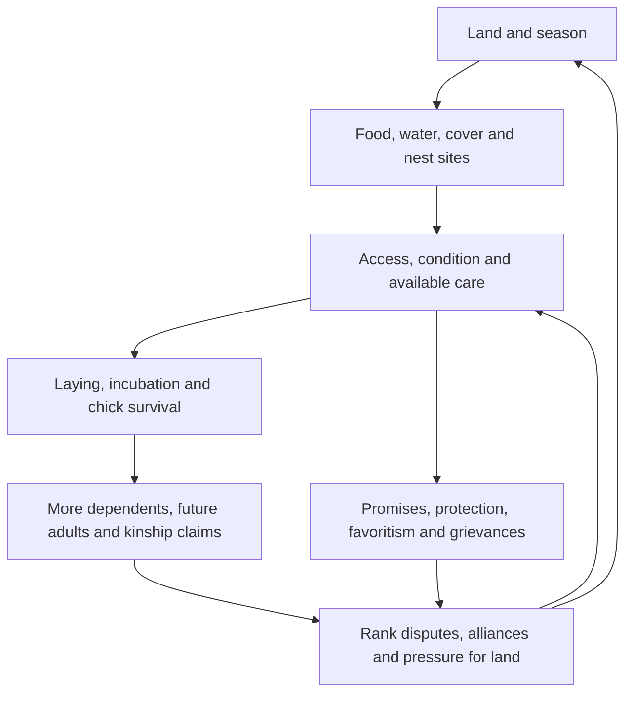

# Proposed gameplay rules for Coop Chaos

Historical design analysis, 16 October 2026. **Proposal, not implemented gameplay
or approved canon.** The accepted [settlement design](../settlement-design.md)
supersedes this document's progression, construction, and next-slice plan.
Retain the biology constraints and social distinctions as background where
compatible; they do not establish a competing roadmap. The player guides the
whole coop with individual agency. World constraints remain in
[the vision](../vision.md) and [world rules](../world.md); sourced biology and its
limits remain in the [research reference](../../docs/research/chicken-biology.md).

Build a society whose future depends on food, safe places, and the willingness
to care for one another. Scarcity creates contested duties. Keeping or breaking
those duties changes relationships and authority. Those relationships determine
who can use the resources needed to raise the next generation.

The long-term aim should be **a continuing, recognizable community**: surviving
seasons and succession while deciding what sort of coop it becomes. Population
and territory are means, with costs. A small trusted coop, a larger stratified
one, and a dispersed alliance should be plausible paths to continuity.

## The causal loop

A meal matters because someone found it, someone claimed it, and someone else
may have gone hungry. A hatch matters because named characters invested in it
and will disagree about what that investment entitles them to.

## Player authority and individual agency

The player chooses community priorities: protected foraging routes, nest claims,
access customs, preparation for winter, responses to disputes, and proposed
pacts. Individuals choose actions within those pressures. Hunger, fear, care for
kin, ambition, and remembered treatment can outweigh an assignment.

An order needs a visible response: accepted, negotiated, resisted, or abandoned,
with a reason. Repeatedly overruling a hen can produce compliance under fear
while weakening trust. Giving a rooster prestige can make him cooperative but
also strengthen a future rival. Emergency retreat can be a strong coordination
signal without granting telepathic control of every distant bird.

The player should see what is known: observed needs, declared intentions, and
remembered incidents. A private motive may become clearer through behavior.
Uncertainty should create interpretation, not hide basic rules or known danger.

## Resources and the claims attached to them

| Resource | What the simulation needs | The human conflict it creates |
| --- | --- | --- |
| Food | Accessible energy and protein, patch regeneration, intake, travel effort. | Who eats first; who does the dangerous gathering; whether privilege yields to need. |
| Water | Reliable usable sources, route access, seasonal scarcity. | Border rights, denied passage, dependence on a rival. |
| Calcium and grit | Calcium availability for laying; separate digestive grit access. Keep both simple at first. | A valuable patch can create obligation and bargaining power. |
| Safe places | Dry incubation sites, chick refuges, usable roosts, overhead cover. | Customary claims versus urgent need; who is exposed when shelter runs short. |
| Care and attention | Time spent incubating, accompanying chicks, watching, resting, and foraging. | Whose ambitions pause; who repays care; who receives credit. |
| Nest material | Local grass, leaves, and twigs where suitable. | Small favors and shared work; not an industrial construction chain. |

Biological grounding: diet and requirements vary by life stage; grit and calcium
serve different functions; pasture alone is not a dependable complete diet for
high-output domestic birds. [Georgia nutrition](https://extension.uga.edu/publications/detail.html?number=C954&title=nutrition-for-the-backyard-flock),
[Extension digestion](https://poultry.extension.org/articles/poultry-anatomy/avian-digestive-system/),
[Oregon pasture nutrition](https://smallfarms.oregonstate.edu/smallfarms/feeding-pastured-poultry).

For this human-free fiction, use locally adapted lineages and an ecology that
can support them at modest reproductive rates. Seeds, insects, water, and usable
mineral sources belong to actual places. Do not assume an invisible supply of
balanced farm feed or apply industrial annual laying rates.

Start with food eaten at patches and limited gathering for dependents. Any
carrying or cache system is a deliberate personification with capacity and
spoilage costs. A universal warehouse would erase the importance of location.

At each ecological update, patch stock equals prior stock plus regeneration
minus consumption and losses, bounded by that habitat's capacity. Individual
condition depends on intake against maintenance, activity, growth, and
reproduction. These are accounting relationships; numerical rates remain
playtest assumptions, not biological measurements.

## Eggs and generations

Treat reproduction as six linked states:

1. **Laying readiness.** Age, condition, season, reproductive state, and lineage
   tendency affect whether a hen lays. Her personal wish to parent is a separate
   fictional motive; a player cannot command her body to produce an egg.
2. **Fertility.** Track reproductive history separately from current rooster
   presence. An egg can be infertile; fertile does not mean guaranteed to hatch.
3. **Incubation commitment.** A suitable broody hen and nest provide continuing
   care. Accepting a clutch reduces her laying and available foraging time.
   Kin or allies may help her remain fed and protected.
4. **Hatching.** Viability, incubation history, and disruption determine the
   result. Attribute failure to understandable conditions; a setback should
   not appear as an unexplained punishment for an arbitrary click.
5. **Chick dependency.** Chicks can move and feed, but need warmth, suitable
   food, refuge, and supervision. Each brood increases immediate pressure before
   it contributes adult labor or protection.
6. **Maturation.** Young birds gain independence and capabilities gradually.
   A maturing cockerel changes male relationships; a pullet develops her own
   place among hens. Neither automatically inherits a parent's rank.

Real incubation is approximately **21 days**. Many layers begin laying around
**18–24 weeks**, with variation. Broodiness can suppress laying, and stored sperm
means fertility can persist after a rooster leaves.
[Maine incubation and fertility](https://extension.umaine.edu/publications/2072e/),
[Wisconsin pullet onset](https://livestock.extension.wisc.edu/articles/judging-ready-to-lay-pullets/),
[Minnesota backyard onset](https://extension.umn.edu/agriculture/animals-and-livestock/poultry/raising-chickens-for-eggs).

Preserve a seasonal calendar and accelerate quiet periods, with automatic pauses
for consequential events. All needs and threats must advance during fast time.
Begin the first scenario with a clutch near hatching and juveniles near maturity
so players see change early without chicks becoming adults overnight. The exact
real-minute pace needs testing.

Track egg identity, biological parentage where known, carers, laying date, and
incubation state. Keep biological kinship distinct from social parenthood and
from what characters believe. A roughly balanced random sex distribution can be
an initial **game assumption**, not a promise for each clutch. Infertile or failed
eggs do not convert to chicks or remain a permanent growing inventory. Egg sales
and an egg-consumption economy are outside this premise.

Declining egg production should not make an elder worthless. Knowledge, trusted
mediation, childcare experience, and remembered obligations can give older
characters continuing influence. These human roles are fictional additions.

## Four kinds of social power

Do not collapse social life into one rank or loyalty score.

| Layer | Meaning | Example |
| --- | --- | --- |
| Dominance | Who usually yields to whom in a contested encounter. | Mallow can displace Bramble from a feeding place. |
| Relationship | Directional affection, trust, fear, and resentment. | Bramble fears Mallow but trusts her to keep a promise. |
| Standing | Recognition and support for a role or claim. | Rowan is physically strong but loses support after favoring his own kin. |
| Kinship and obligation | Family ties, care given, promises, debts, and witnessed acts. | A rival owes Bramble because she sheltered his injured chick. |

Dominance is the biological starting point; the other layers deliberately
personify human social life. Stable dominance often uses signals rather than
continuous fighting, and social experience matters beyond age alone.
[Merck behavior](https://www.merckvetmanual.com/behavior/behavior-of-poultry/behavior-of-poultry),
[Kim and Zuk](https://pubmed.ncbi.nlm.nih.gov/10973726/).

Represent meaningful pairwise dominance relationships and local contests. A
display may end in yielding, retreat, negotiation, or occasional fighting.
Maturation, arrival, injury, leadership loss, and severe scarcity can reopen
claims. Avoid sorting every character by a universal strength value each day.

Hens should influence access, care, custom, coalition building, and succession.
Roosters can earn authority through vigilance, courage, restraint, and kept
promises. Protection can create gratitude, entitlement, dependency, or resentment.
Physical dominance does not automatically grant legitimate rule over all affairs.

Human patterns to dramatize include reciprocity, favoritism toward kin, public
recognition, humiliation, patronage, contested fairness, succession, and double
loyalty. Give different coops different interpretations of these patterns. They
are fictional institutions, not a claim that every human tribe follows one model.

## Land and carrying capacity

Territory is useful only when residents can reach and use it. Estimate how many
birds a coop can support from its **tightest current constraint**: accessible
food, water, safe night space, or care for dependents. Demand depends on body
size, age, condition, and reproductive commitments. A single birds-per-tile
constant cannot express this.

A rich clearing across exposed ground may cost more lives than it sustains.
More land creates longer routes and protection duties. A safe roost can become
the bottleneck while food remains abundant. An established hen can deny access
to food inside friendly borders; a treaty can grant access outside them.

Track ecological condition separately from territorial claims and use rights.
Overuse lowers regeneration; fallow patches or seasonal movement can restore
opportunity. Show projected dependents and safe places before encouraging another
clutch. The player should be able to recognize an unsustainable commitment early.

## Coops and diplomacy

A coop needs members, shared places, recognized customs, remembered agreements,
and relationships with neighbors. Breed is separate from membership and culture.
Several lineages can share one coop; relatives may belong to opposing coops.

Start diplomacy with specific exchanges: water access for warning duty, safe
passage for seasonal forage, shared defense, or shelter for another household.
Each pact records parties, concrete duties, duration or ending conditions, who
knows the terms, and what counts as a breach. “Allied” does not erase grievances.

Marriage or household moves can strengthen a pact, but must involve a named
character with preferences and existing ties. She may seek status elsewhere,
want a partner, protect her kin, resist departure, or be coerced. Track assent
or resistance and subsequent behavior. A coerced arrangement can gain immediate
access while producing divided loyalty, escape, retaliation, or a faction at
home. Marriage, mating, fertility, and political alliance remain separate facts.

Rival males need more outcomes than automatic lethal combat: tolerated junior
roles, negotiated boundaries, withdrawal, a succession challenge, or founding a
neighboring coop. A pact can limit conflict without making rivals friends.
Research supports male competition within shared groups, not a fixed ownership
ratio of one rooster to a set number of hens.
[Johnsen and colleagues](https://doi.org/10.1163/156853901750077754).

War should begin over a legible claim: blocked water, a broken protection promise,
a disputed refuge, or an unresolved expulsion. Escalation spends condition,
care time, and support. Retreat, restitution, and negotiated access need viable
outcomes. Large armies and elaborate conquest systems can wait.

## Predators and protection

Use a coherent provisional temperate woodland ecology. Different threats should
test different decisions; exact species and encounter frequency remain open.

| Threat | Proposed encounter | Meaningful response |
| --- | --- | --- |
| Hawk | Aerial danger over exposed feeding routes. | Watch, alarm, nearby cover, escorted crossings, retreat. |
| Fox | Ground approach using concealed edges; not restricted to nighttime. | Notice signs, change routes, choose defensible refuge, evacuate. |
| Rat or locally appropriate snake | Access to vulnerable nests and chicks. | Nest placement, entry protection, attentive carers. |
| Owl, later | Night exposure at unsafe resting sites. | Sheltered roost choice; height alone does not guarantee safety. |

The predator types and habitat tradeoffs have biological support; the encounter
design above is fictional. Overhead cover can help against aerial attack while
concealing a ground approach. [Virginia Tech predator guidance](https://www.pubs.ext.vt.edu/content/dam/pubs_ext_vt_edu/APSC/apsc-192/APSC-192.pdf).

A rooster's strongest protective contribution should usually be detection,
warning, coordination, and buying escape time. Direct confrontation risks injury
and death. Food calls and vigilance have evidence; invulnerable fox-slaying does
not. Hens can also notice danger and defend young.
[Evans and Evans](https://pubmed.ncbi.nlm.nih.gov/10458882/),
[Kazara](https://ora.ox.ac.uk/objects/uuid:f476fe2b-0d27-4aa9-99c6-861e7c594081).

Use a readable sequence: signs → perceived danger → response opportunity →
encounter → aftermath. Preparedness changes detection and survival; it should not
eliminate all uncertainty. Avoid invisible random deletion of a beloved bird.
Afterward, care, grief, blame, gratitude, and disputed accounts change future
behavior. Give the coop quiet periods in which those consequences can unfold.

## Breeds without character castes

Use Leghorn, Rhode Island Red, Plymouth Rock, Orpington, Brahma, and Silkie as
initial author-facing references. Their physical traits and broad tendencies
are summarized with sources in the [breed reference](../../docs/research/chicken-biology.md#breed-references-and-fictional-lineages).
Translate them into fictional lineage names only when world naming is settled.

Separate silhouette, biological tendency, personality, and culture. A large
Brahma-inspired chicken may be cautious; a small Leghorn-inspired hen may lead.
Broodiness is a tendency and state, not an unavoidable female profession. Egg
color carries no inherent social or reproductive superiority. Mixed ancestry
should remain viable without a complex genetics laboratory or one optimal breed.

## Story tests for the rules

**The insect patch.** Mallow's customary first access leaves Bramble's brood
short of protein. The player can reserve a feeding interval for carers, preserve
the custom and open a riskier route, or negotiate another contribution from
Mallow. The outcome changes intake, exposure, perceived fairness, and support.
Later, Mallow may help enforce a new rule or withhold cooperation. Her reaction
must affect behavior, not only a journal line.

**The protector's choice.** Rowan cannot escort distant foragers and guard an
exposed brood simultaneously. Other adults can help, but have motives and duties
of their own. Assignments expose an understandable gap. A rescue may create an
obligation and leave Rowan injured, altering the next succession dispute.

**The household pact.** A neighbor offers dry-season water if a named hen joins
its household. She wants access for her siblings but fears losing influence at
home. Explore agreement, refusal, an alternative duty, or coercion. Track what
each party actually promised and what she later chooses to do.

**The rising cockerel.** A young protector earns public support while Rowan
still holds rank. The player can negotiate shared duties, back a succession
claim, or support a new coop with continuing kin ties. Strength, legitimacy,
family affection, and fear of abandonment can point in different directions.

These historical scenarios illustrated an earlier narrative test:
**human motive → social tension → player choice → persistent consequence →
visible story feedback**.

## Simulation ownership and scope

Keep the existing pure TypeScript simulation as the rules owner. Babylon shows
the resulting world; React explains intentions and choices. This proposal does
not require a new graphics engine, server, or live language model for every bird.

Model individuals, eggs or clutches, resource patches, territorial use rights,
coop membership, agreements, and significant social memories. Daily scheduling
must account for travel and incompatible duties. Action selection weighs needs,
relationships, risk, and commitments; dialogue expresses those states.

Use a fixed, seeded update order: refresh environmental supply; assess needs
and intentions; resolve travel and access; apply consumption, care, reproduction,
and time-dependent encounters; then update informed characters' memories and
responses. Within a step, explicit event ordering must prevent a dead or absent
carer from supplying care. Save the clock, seed state, active commitments, and
event identifiers so reloading cannot reroll a hatch or duplicate a promise.

Record meaningful incidents with participants, causes, witnesses, and outcomes.
An unwitnessed act does not instantly become common knowledge. Start with direct
witnesses and explicit reports; elaborate rumor propagation can wait. Store
enough history to explain behavior without logging every animation frame.

Present actionable forecasts: mouths to feed, brood care gaps, safe roosts tonight,
known threats, disputed claims, and promised duties. Selecting a bird should
answer “What do they need, what are they doing, and why?”

## Historical first-playable proposal — superseded

The brood-shortage plan below records an earlier proposal, not the current next
slice. The [accepted proof sequence](../settlement-design.md#proof-sequence-and-acceptance)
starts with a construction-delivery journey inside a substantial settlement loop.
The old cast is optional, and cultivation, weaving, storage, and construction
are now central. Earlier exclusions of industry must not be read as banning
those fictional capabilities.

The earlier question was: **Can this coop carry one brood through a shortage
without destroying its relationships?** Start from the existing named cast,
add only the residents needed to create a real care tradeoff, and build food,
water, one clutch, two competing refuge claims, and one readable predator threat.
Use a clutch already near hatching; defer full multi-season life simulation.

That earlier sequence then added one neighboring coop and one access pact, then tested maturation and
succession across a longer calendar. Keep disease simulation, complex inheritance,
large wars, industry, and multiplayer outside the first proof.

The earlier acceptance proposal was:

- Two materially different strategies can sustain the brood, with different
  social costs; one obviously virtuous button must not solve everything.
- A shortage or failed hatch has a traceable cause and a useful earlier signal.
- Protection, incubation, and gathering compete for actual time and location.
- A remembered slight or act of care changes a later action or available choice.
- More eggs do not create cost-free exponential growth; failed eggs and unmet
  care cannot silently count as future adults.
- The same saved state and seed reproduce outcomes, without duplicate events.
- Players can explain the dispute in terms of named characters, not just meters.

The deciding test is whether players care about the next generation **and about
what raising it asks of the people already here**.
